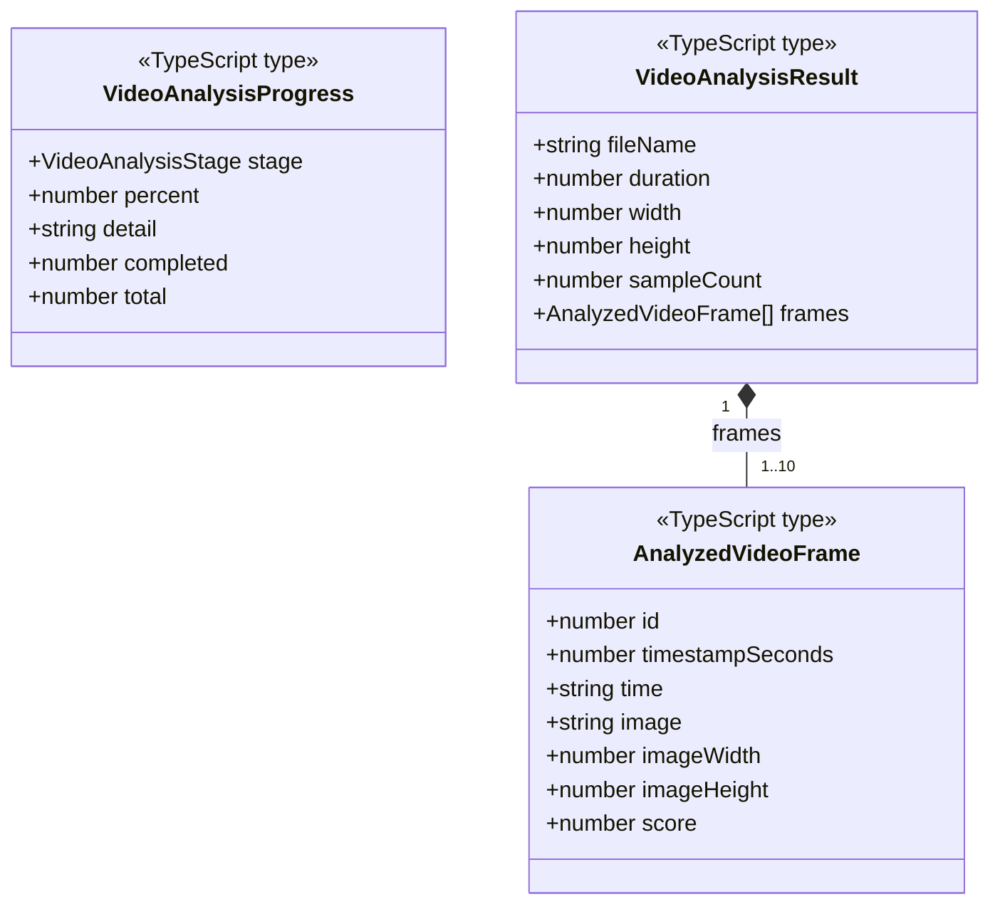
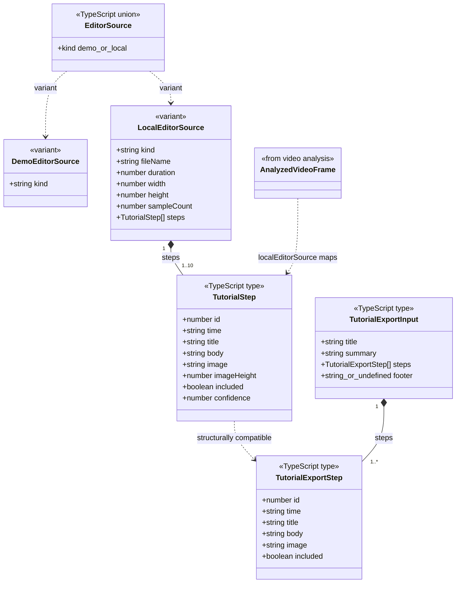
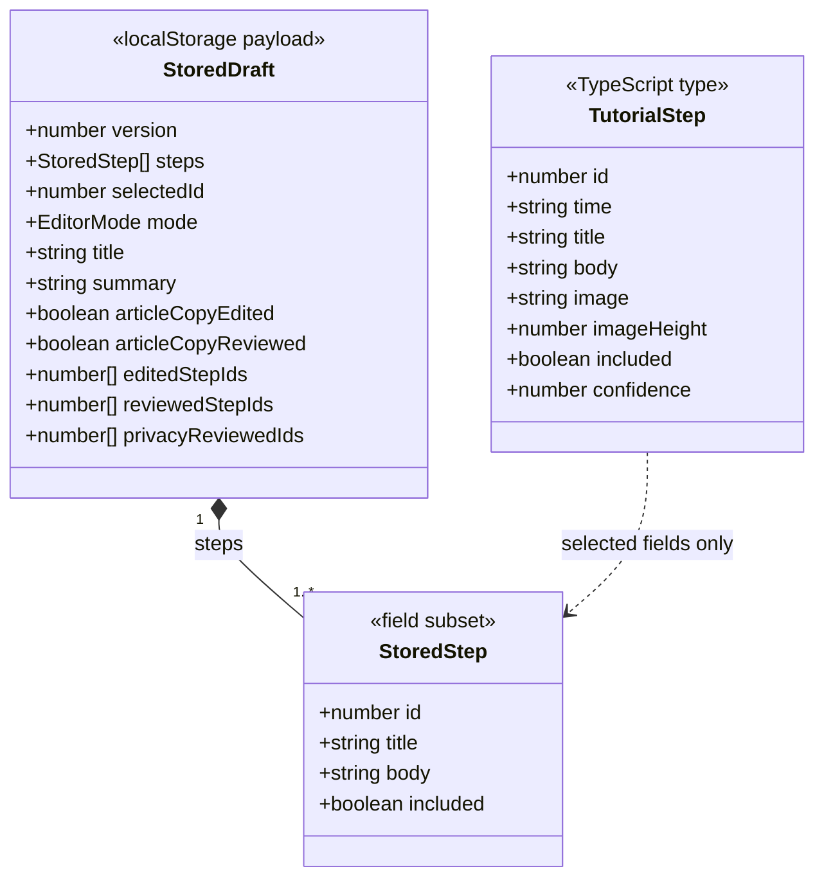

# Web 数据模型

本文件中的图描述 TypeScript 结构关系。`type` 在运行时会被擦除，因此图中的类型不是持久化实体，也不代表数据库表。

## 视频分析结果

说明：

- `image` 是当前页面内的 JPEG data URL，不是服务器文件地址。
- 几乎静态的视频可以只产生一张候选帧，因此运行时下限是 1。
- `score` 表示画面变化启发式分数，不是步骤语义置信度。

## 编辑与导出模型

关键转换：

1. `analyzeVideo()` 返回 `VideoAnalysisResult`。
2. `localEditorSource()` 把每个 `AnalyzedVideoFrame` 转成 `TutorialStep`。
3. 新步骤的正文是明确的人工占位说明，必须被替换才能交付。
4. `TutorialStep` 比导出结构多 `imageHeight` 与 `confidence`；导出函数只读取结构兼容的字段。
5. `included = false` 的步骤保留在编辑器中，但不参与发布门禁和最终导出。

图中的 `DemoEditorSource`、`LocalEditorSource` 是 `EditorSource` 内联联合分支的概念名称，`StoredStep` 是草稿所保存字段子集的概念名称；它们不是源码中可直接搜索到的独立命名类型。

## 示例草稿模型

草稿约束：

- 存储键为 `recnote-demo-draft-v5-muwa-board`，当前草稿版本为 `2`。
- 只有示例流程会持久化该结构；`UploadView` 会读取它以显示恢复入口，`EditorView` 在 `source.kind === "demo"` 时读取和写入完整草稿。
- `time`、`image`、`imageHeight` 和 `confidence` 不进入 `localStorage`，恢复时从受控示例常量重新取得。
- 真实视频的 `File`、data URL、教程步骤和复核状态不进入该草稿模型。

## 发布门禁的派生集合

这些集合是 React 内存状态，不是额外的持久化实体：

| 集合或标记 | 含义 | 修改时的规则 |
| --- | --- | --- |
| `editedStepIds` | 已被编辑的步骤 | 修改标题或正文时加入 |
| `reviewedStepIds` | 文字与画面已核对的步骤 | 再次修改同一步骤时移除 |
| `privacyReviewedIds` | 已人工检查隐私的截图 | 用户逐张确认后加入 |
| `articleCopyEdited` | 标题或摘要已修改 | 修改标题或摘要时设为 `true` |
| `articleCopyReviewed` | 标题与摘要已复核 | 再次修改标题或摘要时设为 `false` |

只有纳入成稿的步骤参与上述门禁计数。
