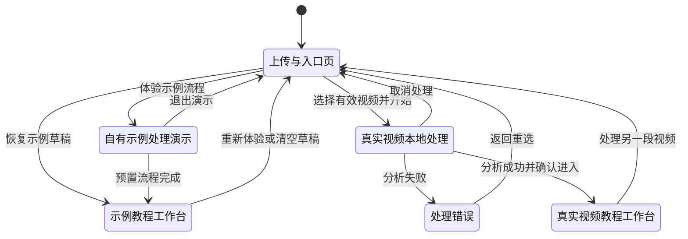
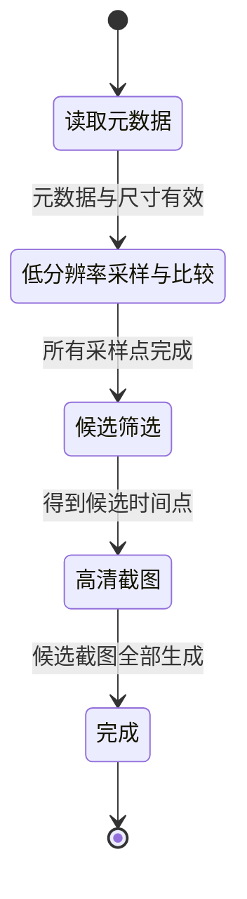
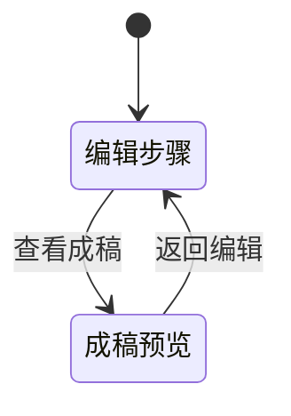
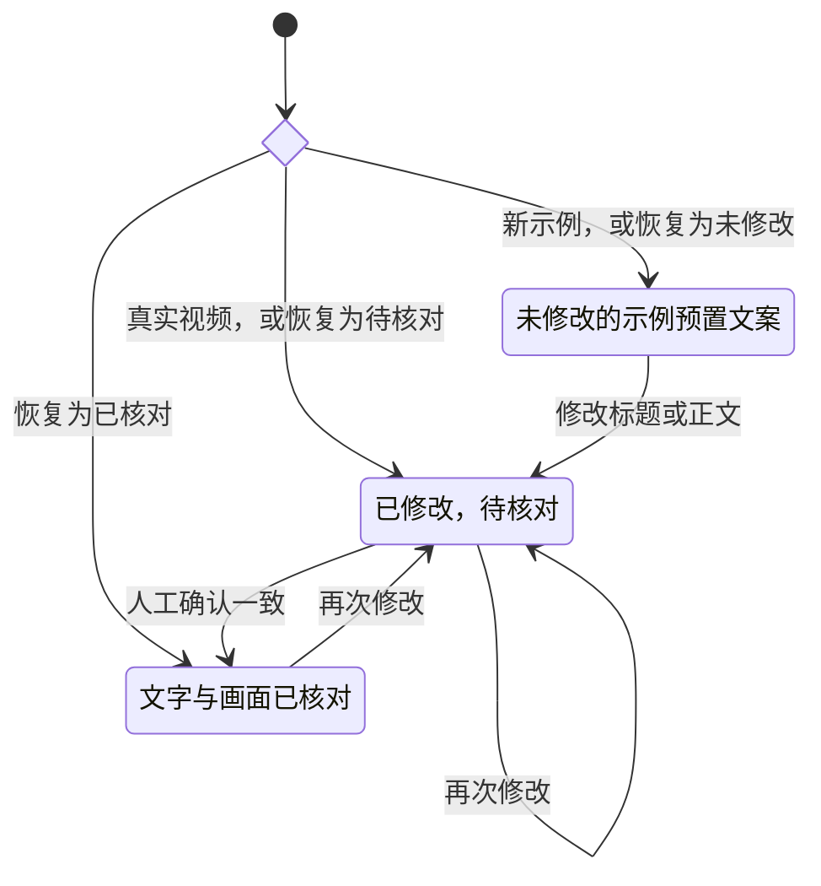

# Web 状态机

## 页面生命周期

`Home` 只保存三个顶层阶段：`upload`、`processing`、`editor`。示例流程和真实视频流程在 `processing` 与 `editor` 中通过输入数据区分。

状态事实：

- `ProcessingDemo` 是展示 CLI 候选结果与 Web 预置初稿之间尚未连接的示例，不会分析视频。
- `ProcessingLocal` 创建 `AbortController`；组件卸载或用户取消时终止分析。
- `EditorLocal` 的状态只在当前 React 会话中存在，刷新页面后不会恢复。

## 视频分析阶段

`VideoAnalysisStage` 只包含图中的五个正常阶段。错误与取消通过 Promise rejection / `AbortError` 处理，不伪装成该联合类型中的额外状态。

## 编辑模式

切换模式不会改变教程内容或复核状态。

## 单步文案复核状态

真实视频步骤在进入工作台时就被视为“已修改、待核对”，因为默认正文只是人工占位说明。
示例草稿恢复时，保存的 `editedStepIds` 与 `reviewedStepIds` 会覆盖新示例的默认入口状态。

## 发布门禁

发布就绪不是一个单线状态机，而是五个并行条件的合取：

| 条件 | 通过规则 | 失败后行为 |
| --- | --- | --- |
| `contentReady` | 标题、摘要、至少一个纳入步骤及其标题正文均非空；真实视频占位说明已替换 | 阻止交付并要求补全真实说明 |
| `timestampsReady` | 每个纳入步骤都有时间戳 | 阻止交付 |
| `screenshotsReady` | 每个纳入步骤都有截图 | 阻止交付 |
| `copyReviewReady` | 所有被修改的步骤、标题和摘要都已重新复核 | 显示剩余待核对数量 |
| `privacyReady` | 每个纳入步骤的截图都已被逐张人工确认 | 显示隐私检查进度 |

只有五项全部为 `true` 时，`publishReady` 才为 `true`，复制和下载请求才会继续。

## 状态失效规则

- 修改步骤标题或正文：保留 `edited`，清除该步骤的 `reviewed`。
- 修改文章标题或摘要：设置 `articleCopyEdited = true`，同时设置 `articleCopyReviewed = false`。
- 隐藏步骤：该步骤不再参与门禁和导出；恢复后重新纳入计数。
- 调整顺序：不改变文字复核与隐私复核结果。
- 清空示例草稿：删除 `localStorage` 条目，无法撤销。
