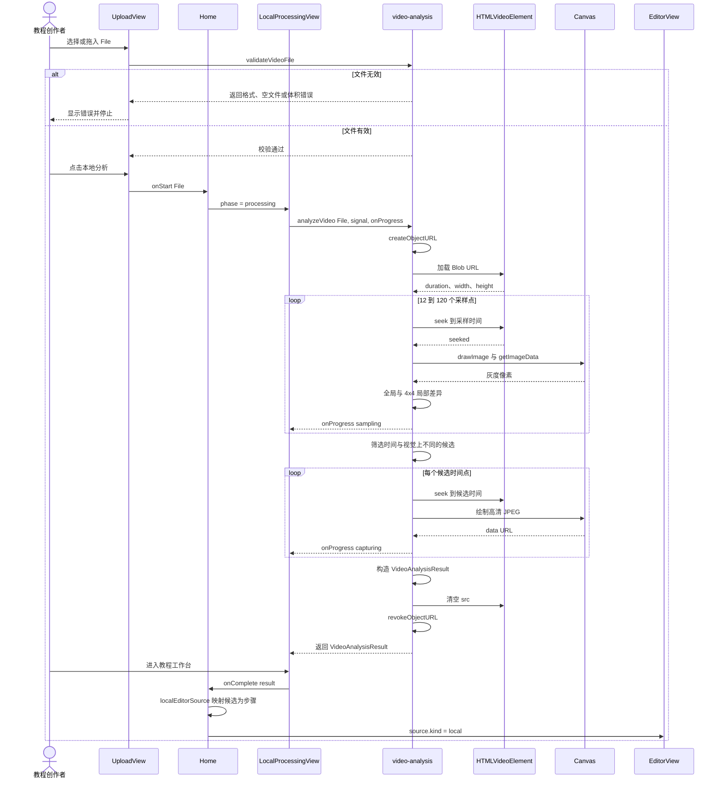
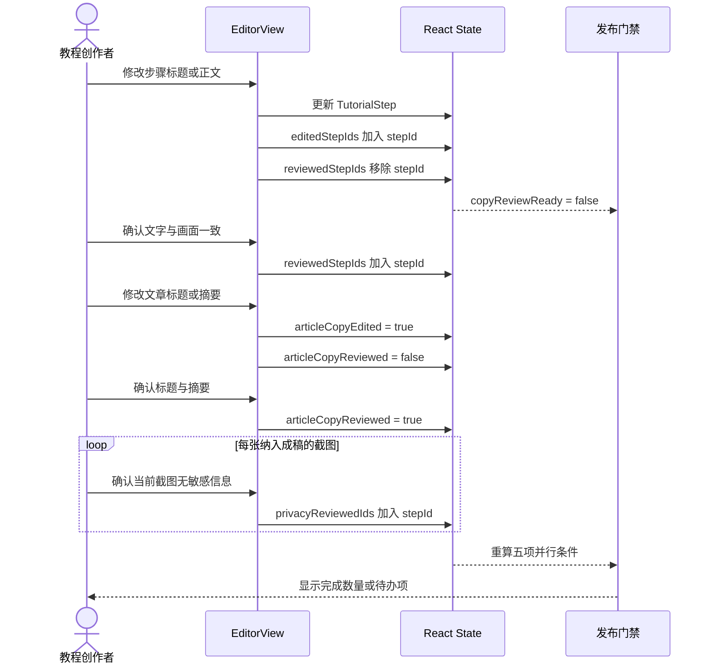
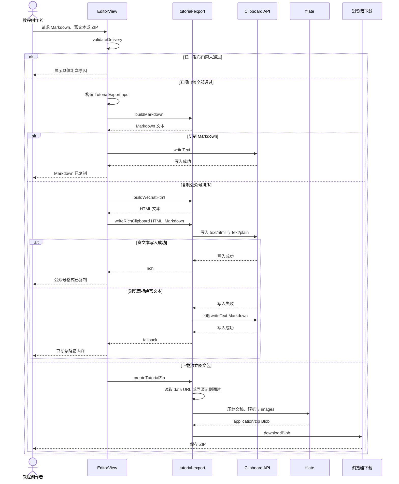
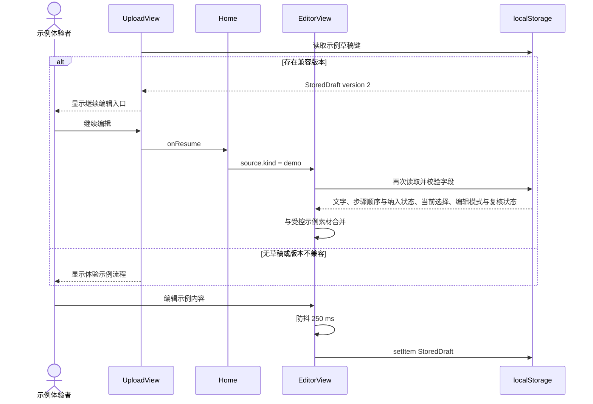
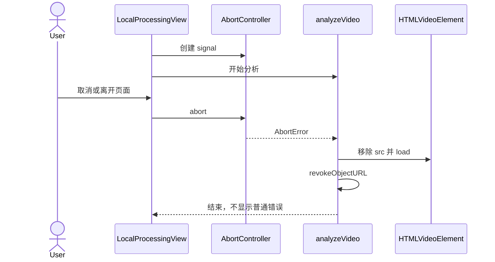

# Web 时序图

## 真实视频本地分析



整个序列中没有上传请求、服务器媒体处理器或模型 API。唯一被处理的是用户主动选择的本地 `File`。

## 编辑与复核



截图隐私确认是人工声明，不代表系统已经自动识别或处理敏感信息。

## 教程交付



ZIP 内部契约：

```text
教程标题/
├── 教程.md
├── 公众号预览.html
├── 使用说明.txt
└── images/
    ├── step-01.jpg
    └── ...
```

## 自有示例草稿恢复



`source.kind = local` 时，`EditorView` 不执行这条持久化序列；真实视频草稿刷新后即丢失。

## 取消与资源释放


