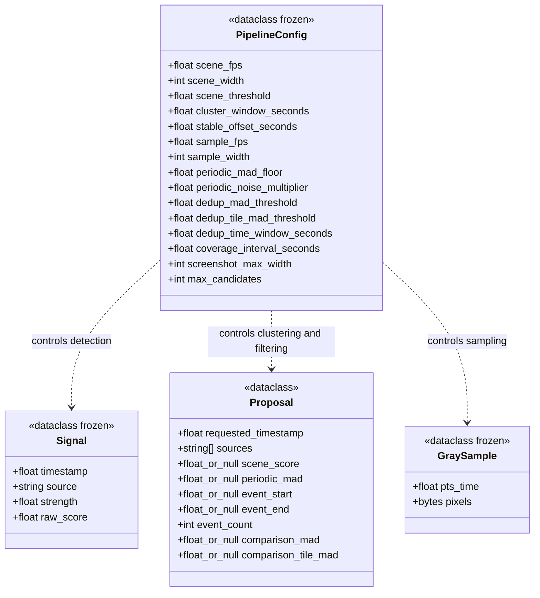
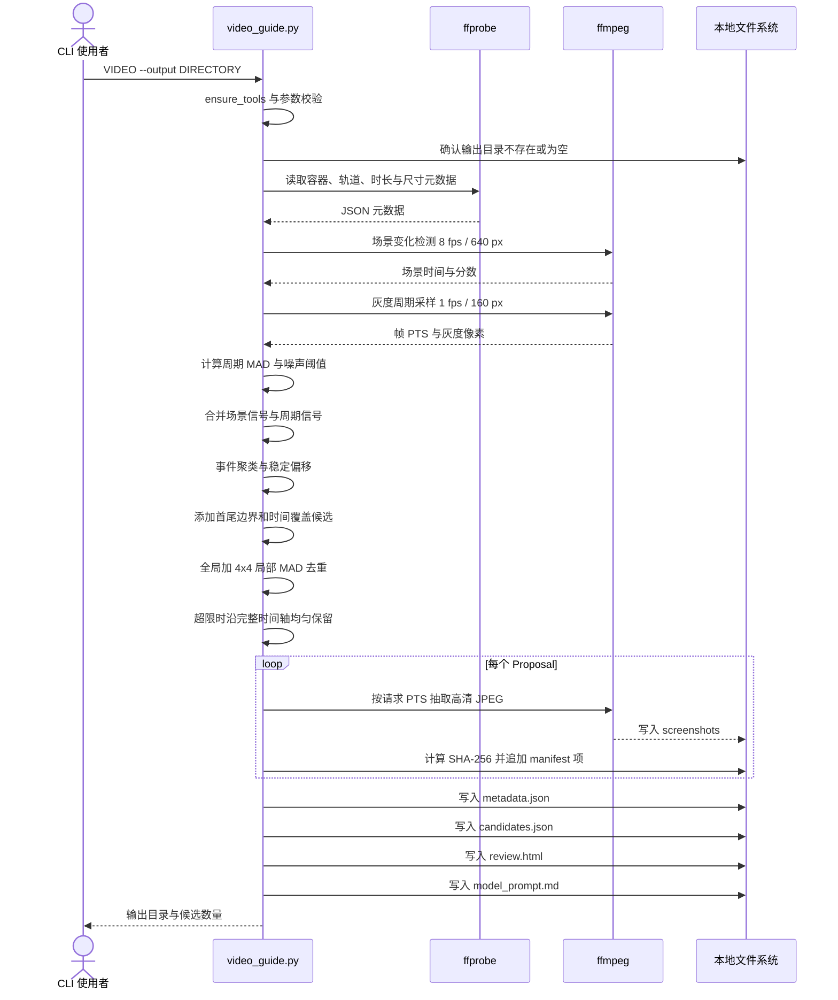
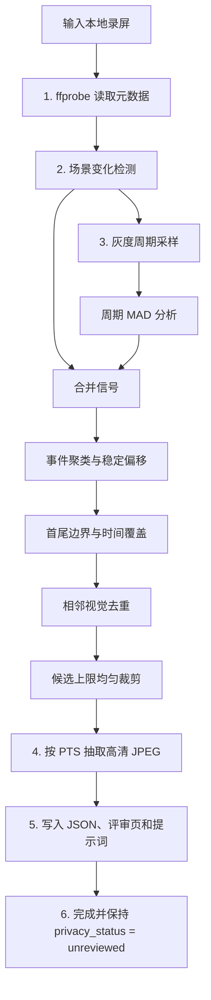

# CLI 管线

CLI 是独立的离线候选帧提取工具。它不被 Web 调用，也不会连接网络或模型 API。

## 核心数据结构

`video_guide.py` 主要采用过程式函数；下图中的四个类型是 Python `dataclass`，不是服务或数据库实体。



`Signal`、`GraySample` 与 `Proposal` 是不同处理阶段的函数输入或返回值，并不互相持有对象引用；它们的转换关系见下方管线图。边界候选与时间覆盖候选也可以在没有对应 `Signal` 的情况下形成。

## 处理时序



## 管线阶段辅助图

下面使用流程图表达算法活动，方便快速定位实现；它不是 Mermaid 原生 UML 活动图。



## 输出契约

```text
result/
├── metadata.json
├── candidates.json
├── review.html
├── model_prompt.md
└── screenshots/
    ├── C001_000000.500s.jpg
    └── ...
```

| 产物 | 职责 |
| --- | --- |
| `metadata.json` | 输入哈希、媒体元数据、工具版本、参数、统计、降级和安全声明 |
| `candidates.json` | 候选 ID、请求时间戳、截图哈希、检测信号与人工评审字段 |
| `review.html` | 完全离线的候选评审页，可导出独立的 `review-result.json` |
| `model_prompt.md` | 用户在人工脱敏后可自行使用的多模态整理提示词，不会自动发送 |
| `screenshots/` | 按候选 PTS 请求生成的高分辨率 JPEG |

## 时间戳与隐私约束

- 分析使用 ffmpeg 的 `pts_time`，不使用“帧号除以标称帧率”猜测时间。
- `requested_seconds` 是截图请求目标；当前尚未测量真实解码帧 PTS，因此 `actual_seconds` 明确为 `null`。
- 元数据只保存源文件名，不保存用户设备上的绝对路径。
- 所有候选截图初始均为 `privacy_status: unreviewed`。
- 非空输出目录和符号链接会被拒绝，CLI 不会覆盖已有人工结果。
- 原始视频不会被复制到输出目录。

## Web 与 CLI 的关系

| 维度 | Web | CLI |
| --- | --- | --- |
| 调用环境 | 浏览器 | 本机 Python 进程 |
| 视频解码 | `HTMLVideoElement` | `ffmpeg` / `ffprobe` |
| 候选规模 | 1–10 张 | 默认最多 80 张，可配置 |
| 主要目标 | 快速进入编辑、复核和导出 | 可复现的离线候选提取与评审 |
| 状态交换 | 无 | 无 |
| 网络或模型 | 无视频上传或第三方模型调用；应用代码与公开示例素材由托管站点分发，示例 ZIP 会读取同源公开图片 | 无网络或模型调用 |

两条链路当前没有导入/导出适配器。CLI 产物不会自动进入 Web 工作台。
