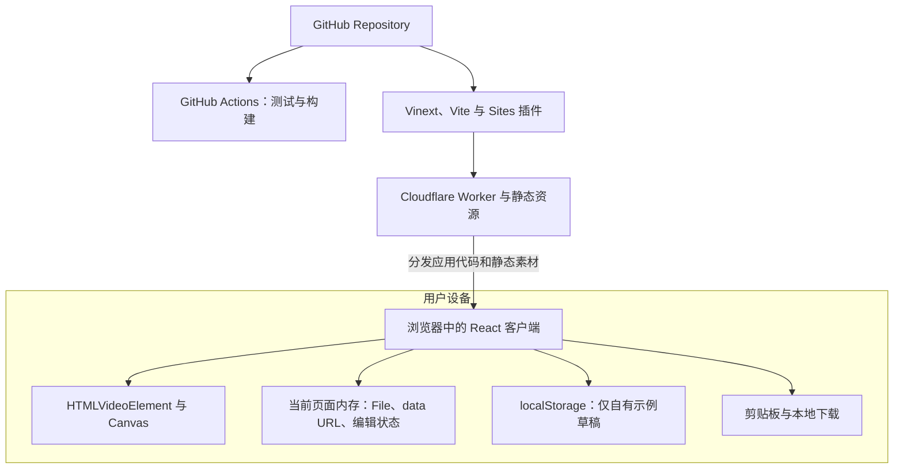
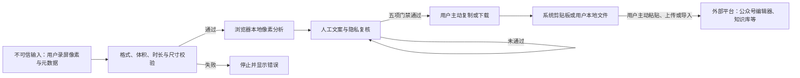
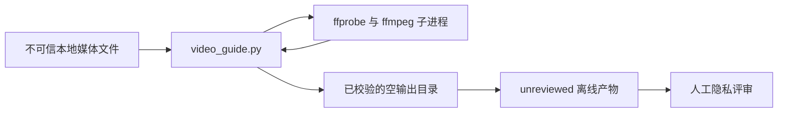

# 部署与隐私边界

Mermaid 没有稳定的标准 UML 部署图语法。下面使用运行拓扑辅助图和边界表表达真实部署，不把不存在的数据库、上传服务或模型服务画进系统。

## 构建与运行拓扑

## 部署节点

| 节点 | 技术 | 处理的数据 | 持久化 |
| --- | --- | --- | --- |
| GitHub | 源代码仓库与 Actions | 代码、自有测试夹具、文档 | Git 历史 |
| Sites / Cloudflare Worker | Vinext RSC 运行时和静态资源分发 | 页面代码、公开示例素材 | 不保存用户视频 |
| 用户浏览器 | React、Media Element、Canvas、Clipboard、Blob | 用户主动选择的视频、候选截图、教程草稿 | 真实视频仅当前会话；示例草稿可写 `localStorage` |
| 用户文件系统 | 浏览器下载或 CLI 输出 | ZIP、Markdown、HTML、JSON、JPEG | 由用户控制 |
| Python CLI 进程 | Python 标准库、ffprobe、ffmpeg | 本地视频与离线候选产物 | 只写用户指定目录 |

当前 `.openai/hosting.json` 中 `d1` 与 `r2` 均为 `null`。

## Web 信任边界

边界规则：

- 视频内容被当作不可信像素输入，不会被解释为指令。
- Web 分析代码没有视频上传请求，也没有第三方模型调用。
- `tutorial-export` 的 `fetch` 只用于读取同源自有示例图片并装入 ZIP；真实视频截图直接来自 data URL。
- Blob URL 在分析结束、失败或取消后撤销。
- 只有用户主动复制或下载，教程内容才会被带到系统剪贴板或用户本地文件；录见无法观测用户之后是否粘贴、上传或发布到外部平台。
- 自有示例是上述规则的明确例外：编辑后的字段子集会自动写入同源 `localStorage` 以支持恢复，但不会写入服务器；真实视频、候选截图和真实视频草稿不会进入该存储。
- 截图隐私复核是人工门禁，不是自动检测结果。

## CLI 信任边界

CLI 不执行画面中的命令，不联网，不自动发送 `model_prompt.md`，也不复制原始视频。所有截图初始状态均为 `unreviewed`。

## 当前不存在的运行节点

- 视频上传 API；
- 对象存储桶或 R2 视频空间；
- D1 项目数据库；
- 后台任务队列；
- 服务端 ffmpeg worker；
- 大模型或多模态模型网关；
- 自动隐私检测、脱敏或打码服务。

这些能力若未来实现，必须先更新隐私说明、威胁边界和本目录图表，再对外声明。
