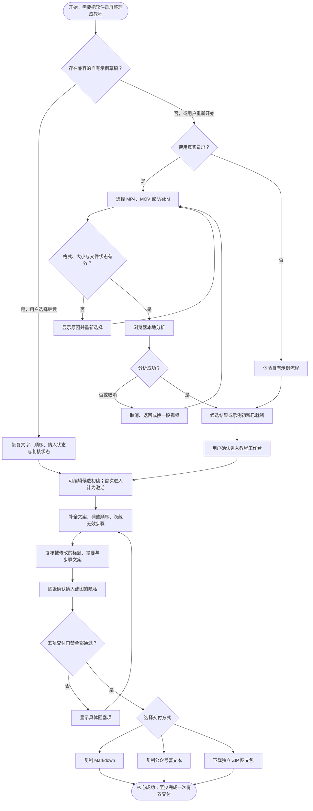
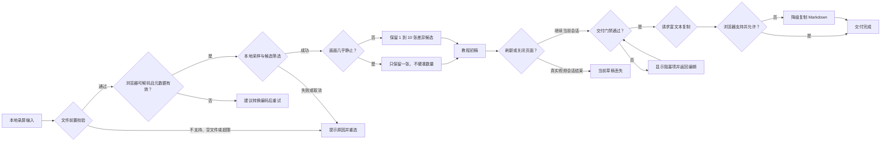
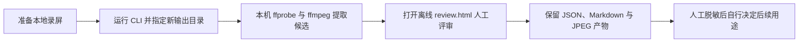

# 产品活动与用户旅程

本文从产品经理视角回答一个问题：用户怎样从“一段已经录好的软件操作视频”走到“一份通过人工复核、可以继续发布的图文教程”。

当前版本是匿名、单人、本地优先的 Web MVP。录屏制作和最终发布都发生在录见之外；录见负责从本地录屏输入开始，到生成可复制或下载的交付物结束。

Mermaid 没有稳定的标准 UML Activity Diagram 语法。本文使用 `flowchart` 表达活动关系，属于产品活动辅助图，不冒充标准 UML 活动图。

## Web 核心活动流

产品定义中的两个关键节点：

- **激活**：用户首次进入可编辑候选初稿，而不是只打开首页或选择文件。
- **核心成功**：五项交付门禁全部通过，并完成一次符合所选格式的有效交付。Markdown 复制成功只代表文本交付；需要连同真实视频截图形成完整素材包时，以 ZIP 下载成功为准。

`核心成功` 不等于教程已经发布。当前系统无法知道用户是否把结果粘贴到公众号、知识库或其他平台，也无法验证读者能否照着教程完成任务。

## 用户旅程

| 阶段 | 用户目标 | 用户动作 | 系统反馈 | 完成标准 | 失败与恢复 | 建议验证指标 |
| --- | --- | --- | --- | --- | --- | --- |
| 准备素材 | 让系统读取一段可处理的录屏 | 选择或拖入本地文件 | 显示文件名、大小、格式与边界说明 | 文件通过前置校验 | 重新选择；必要时转为 H.264 MP4 | 有效文件选择率 |
| 获得候选 | 尽快看到值得保留的关键画面 | 启动本地分析并等待 | 显示阶段、进度、采样数与候选数 | 进入可编辑候选初稿 | 取消、返回重选；静态视频只保留一张 | 首次初稿时间、候选召回率 |
| 整理教程 | 把候选画面变成真实可读的操作步骤 | 替换占位说明、改标题摘要、排序或隐藏步骤 | 即时更新编辑区与成稿预览 | 至少保留一个内容完整的步骤 | 补全缺失字段；恢复被隐藏步骤 | 候选隐藏率、文案重写率、缺失步骤数 |
| 人工复核 | 确认教程准确且适合对外使用 | 核对修改内容；逐张检查隐私 | 显示待核对数量、隐私进度与五项门禁 | `publishReady = true` | 修改后重新复核；逐项完成阻塞项 | 从初稿到就绪耗时、复核返工率 |
| 交付内容 | 把成稿带到下一工作环节 | 复制 Markdown、复制富文本或下载 ZIP | 成功提示、降级提示或具体错误 | 完成所选格式的有效交付；完整图片素材以 ZIP 为准 | 富文本失败降级 Markdown；其他错误可重试 | 各格式成功率、抽样回访或用户自报发布率 |

当前代码没有产品分析 SDK，也不会默认上报这些指标。验证阶段应优先通过用户访谈、脱敏样本对照和自愿提交的本地结果收集数据，而不是为了埋点破坏本地优先承诺。公式、样本、阈值和决策规则见[产品验证指标与决策规则](10-product-validation-metrics.md)。

## 异常与恢复活动辅助图

## 当前恢复能力矩阵

| 异常 | 当前处理 | 是否保留工作 | 产品风险 |
| --- | --- | --- | --- |
| 文件类型、空文件或体积无效 | 阻止开始并显示原因 | 尚未产生工作 | 低 |
| 编码无法解码、时长或尺寸异常 | 分析失败，返回重选 | 尚未产生初稿 | 中；格式名可接受不代表编码可解码 |
| 用户取消、seek 超时或 Canvas 失败 | 终止分析并释放临时媒体资源 | 尚未产生初稿 | 中 |
| 关键步骤漏检、候选画面截错或不适合讲解 | 当前不能在产品内补帧或替换截图；只能重新分析、重录，或导出后在录见外补图 | 已有编辑工作只能部分保留，重新分析会新建会话 | 高；是候选池、手工增删帧和截图替换进入下一阶段的核心依据 |
| 真实视频编辑中刷新或关闭 | 当前会话状态丢失 | 否 | 高；是下一阶段本地草稿能力的核心理由 |
| 示例草稿损坏或版本不兼容 | 忽略或清除草稿，重新体验 | 否或只保留有效字段 | 低；示例可重建 |
| 修改已复核文案 | 对应复核自动失效 | 是 | 可控；防止历史确认失真 |
| 任一纳入截图未做隐私确认 | 阻止全部交付 | 是 | 可控；需要逐张完成 |
| 富文本剪贴板不可用 | 降级复制 Markdown | 是 | 低 |
| 普通剪贴板、示例图片读取或 ZIP 压缩失败 | 显示交付错误，允许重试 | 是，仅当前会话 | 中 |

当前恢复规则统一见 `BR-RC-01` 与 `BR-RC-02`。候选漏检不是单纯的算法指标问题，而是产品是否给用户提供可修复路径的问题；V1 候选方案见 [V1 To-Be 产品蓝图](11-v1-target-product-blueprint.md)。

## CLI 辅助旅程

CLI 不是 Web 主旅程的一部分，而是高级用户或工程验证的独立离线路径。

CLI 与 Web 当前没有导入适配器、共享项目或状态交换。完整算法与产物契约见 [CLI 管线](05-cli-pipeline.md)。
