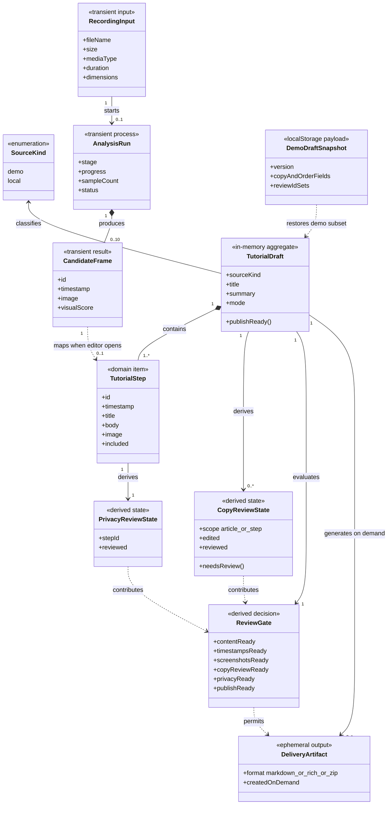

# 产品领域模型

本文使用产品语言描述录见当前业务概念及其关系。它回答“产品在管理什么”，不回答 TypeScript 类型怎样声明，也不代表数据库表。

当前版本没有账号、项目数据库或教程历史。图中的分类器是分析与沟通用的产品领域概念，部分概念在代码中只表现为 React 状态、集合或函数返回值。

## 当前领域类图

## 聚合边界与业务含义

| 概念 | 产品含义 | 当前生命周期 | 是否持久化 |
| --- | --- | --- | --- |
| `RecordingInput` | 用户主动选择的源录屏 | 从文件选择到页面会话结束 | 否 |
| `AnalysisRun` | 一次浏览器本地分析 | 开始、进度、成功、失败或取消 | 否 |
| `CandidateFrame` | 可能代表关键操作的带时间戳画面 | 分析成功后先出现在候选结果页；进入工作台时再映射 | 否 |
| `TutorialDraft` | 用户正在整理的教程成稿 | 当前编辑会话 | 真实视频否；示例只保存字段子集 |
| `TutorialStep` | 一张画面及其时间、标题、说明和纳入状态 | 随草稿编辑 | 同上 |
| `CopyReviewState` | 被修改内容是否已人工核对 | 修改时失效，确认时恢复 | 示例保存 ID 与文章级布尔值 |
| `PrivacyReviewState` | 纳入截图是否已人工检查 | 逐张确认 | 示例保存 ID |
| `ReviewGate` | 五项条件的实时合取结果 | 每次相关状态变化时重算 | 否 |
| `DeliveryArtifact` | 用户主动生成的 Markdown、富文本或 ZIP | 复制或下载时生成 | 产品不保存，由用户设备或外部平台管理 |
| `DemoDraftSnapshot` | 自有示例可恢复的最小字段集合 | 250 ms 防抖保存，版本不兼容时放弃恢复 | 浏览器 `localStorage` |

## 领域不变量

1. 一个真实视频 `AnalysisRun` 成功后产生 1–10 张候选画面；失败或取消时可以没有结果，几乎静态的录屏成功后可以只有一张。
2. 用户确认进入教程工作台时，当前 Web 才把每张 `CandidateFrame` 机械映射为一个带占位说明的 `TutorialStep`；这不是语义理解。
3. `TutorialDraft` 至少要有一个 `included = true` 且内容完整的步骤，才可能进入交付就绪。
4. 被隐藏的步骤仍属于草稿，但不参加门禁计数和导出。
5. 修改文案会使对应 `CopyReviewState` 失效；调整顺序本身不会使文案或隐私复核失效。
6. 每个纳入步骤必须拥有截图、时间戳和人工隐私确认，才能通过 `ReviewGate`。
7. `ReviewGate` 是派生决策，不是可单独修改的业务实体。
8. `DeliveryArtifact` 只在用户主动请求时生成；当前产品不保留导出历史。
9. 示例流程不会执行真实 `AnalysisRun`，其录屏、截图和时间来自仓库内受控素材。
10. `Exported` 只表示交付物生成成功，不代表内容已经在外部平台发布。

## 产品概念与当前代码映射

| 产品概念 | 当前代码表达 | 说明 |
| --- | --- | --- |
| `RecordingInput` | 浏览器 `File` | 只保留当前会话引用 |
| `AnalysisRun` | `analyzeVideo()`、`VideoAnalysisProgress` | 没有稳定运行 ID |
| `CandidateFrame` | `AnalyzedVideoFrame` | `score` 是视觉变化分数，不是语义置信度 |
| `TutorialDraft` | `EditorView` 内的 React 状态与 `EditorSource` | 没有同名对象或数据库记录 |
| `TutorialStep` | `TutorialStep` | 真实视频由 `localEditorSource()` 机械映射 |
| `CopyReviewState` | `editedStepIds`、`reviewedStepIds`、文章级两个布尔值 | 使用集合和布尔值表达 |
| `PrivacyReviewState` | `privacyReviewedIds` | 只记录人工确认 ID |
| `ReviewGate` | 五个 `*Ready` 布尔值与 `publishReady` | 每次渲染派生 |
| `DeliveryArtifact` | `buildMarkdown()`、`writeRichClipboard()`、`createTutorialZip()` | 不保存生成记录 |
| `DemoDraftSnapshot` | `StoredDraft` | 只适用于自有示例 |

实现层字段和类型关系见 [Web 数据模型](02-web-data-model.md)。

## 当前明确缺失的领域对象

下列对象不应出现在当前实现类图中，因为代码尚未提供对应能力：

| 缺失对象 | 对应产品能力 | 当前状态 |
| --- | --- | --- |
| `User`、`Organization`、`Workspace` | 账号、组织、权限和多人协作 | 未定义 |
| `LocalProject`、`ProjectSnapshot` | 真实视频本地草稿与最新可恢复快照 | V1 To-Be 待验证目标；尚未实现 |
| `TutorialVersion` | 完整版本树、分支、回滚 | 不进入最小 V1；尚未定义 |
| `FrameSelection` | 候选池、手工增删帧和步骤截图替换映射 | V1 To-Be 待验证目标；尚未实现 |
| `ModelConsent`、`SemanticSuggestion` | 用户授权后的可插拔语义建议 | V1 默认关闭的实验支路；尚未实现 |
| `ImageEdit` | 裁剪、标注和人工遮挡 / 模糊的派生操作 | V1 To-Be 待验证目标；尚未实现 |
| `ReviewAssignment`、`Approval` | 审核者分工、意见和审批流 | 未定义 |
| `PublicationTarget`、`PublicationRecord` | 直连公众号或知识库并记录发布结果 | 未定义 |
| `Plan`、`Subscription`、`Entitlement` | 套餐、计费和商业权益 | 未定义 |

这些对象只有在对应需求经过验证并进入开发范围后，才能进入当前实现模型；不能仅因为“完整产品可能需要”就画成现有实体。V1 候选对象及其边界单独见 [V1 To-Be 产品蓝图](11-v1-target-product-blueprint.md)。
