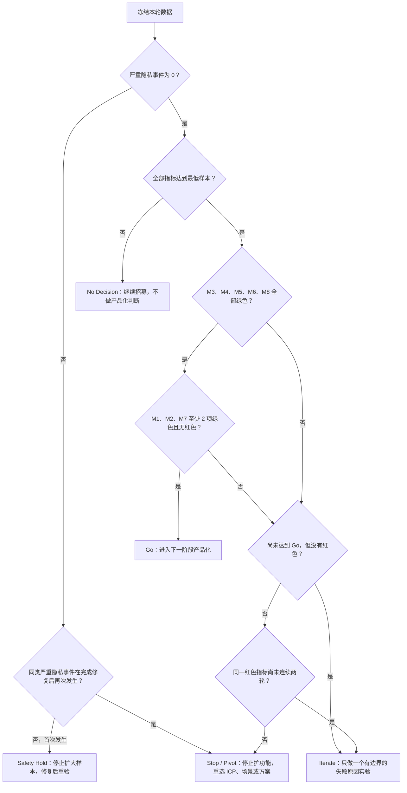

# 产品验证指标与决策规则

本文回答三个产品问题：首轮先验证谁、怎样计算“有效”、什么证据足以决定继续、迭代或停止。

当前仓库没有产品分析 SDK、账号或计费系统。以下样本量、周期和阈值全部标记为 **`[H]` 待验证假设**，用于避免验证结束后按结果临时改标准；它们不是当前事实、性能承诺或正式排期。

## 首轮验证对象

| 项目 | 首轮定义 | 状态 |
| --- | --- | --- |
| 首要 ICP | 每月制作 `[H] ≥ 4` 篇软件操作教程或产品演示的高频个体创作者；优先招募产品经理、企业培训师、实施顾问和独立课程作者 | 待验证假设 |
| 典型输入 | 当前公开上限内（≤ 5 分钟）的桌面软件录屏；用户愿意人工补全文案并检查隐私 | 输入上限是当前事实，使用习惯待验证 |
| 当前使用者 | 匿名、单人教程创作者 | 当前事实 |
| 首轮付费者 | 使用者本人；为稳定节省整理时间、减少漏步骤和返工付费 | 待验证假设 |
| 第二付费者 | SaaS 客户成功、产品运营或培训团队负责人 | 第二阶段假设，不参与首轮 Go 判断 |

GitHub Star、下载、点赞、问卷中的“愿意考虑”和口头好评都不是付费证据。付费信号必须来自完成真实任务后的统一报价，并产生实际付款或不可忽略的定金。

## 验证设计

### 阶段 A：配对任务验证

- `[H] 12` 名符合首要 ICP 的用户。
- 每人完成 `[H] 2` 个难度相近的脱敏真实任务：一个纯手工完成，一个使用 RecNote，形成 `[H] 12` 个被试内匹配对。
- 共 `[H] 24` 次任务执行（12 次纯手工、12 次 RecNote），周期 `[H] 2` 周。
- 任务与方法顺序采用平衡分配，避免所有人都先手工或都先使用 RecNote 造成学习效应。
- 两种方法使用相同的完成标准；独立评审者在不知道所用方法的情况下检查结果。

### 阶段 B：真实场景验证

- `[H] 20–30` 名符合首要 ICP 的用户，自愿使用 `[H] 4` 周。
- 复用率只统计期间确实有第二次教程生产机会的用户，不把“没有新任务”算作流失。
- 阶段结束后，对至少 `[H] 15` 名完成过真实任务的合格用户给出同一个 `offer_id` 的试点报价；合格名单必须先按统一规则冻结并全部触达，权益、价格、服务周期和退款说明必须在报价前冻结。
- 只有实际付款，或同时达到“试点价 `[H] ≥ 10%` 且 `[H] ≥ 99 元`”的定金，才计入付费信号；小额意向金和可随时撤销的口头承诺不计入。

### 数据采集原则

- 不为了验证默认上传视频、截图或教程内容。
- 优先使用研究编号、本地时间记录表、脱敏结果检查表和用户自愿回访。
- 原始视频只有在用户明确同意后才进入研究样本；未同意时只提交汇总数据。
- 隐私与质量评审优先使用自有、合成或完成脱敏的素材。

## 统一口径

| 术语 | 口径 |
| --- | --- |
| 合格输入会话 | 视频符合公开的格式、非空、500 MB 与 5 分钟边界；浏览器最终无法解码仍计入激活失败 |
| 激活 | 用户首次进入真实视频的可编辑候选初稿 |
| 人工金标准关键步骤 | 独立评审者先观看原视频，在看候选结果前标出的完成任务所必需步骤 |
| 候选覆盖关键步骤 | 至少一张候选画面能清楚看出完成该步骤所需的界面状态 |
| 有交付意图 | 用户在任务开始前明确表示本次要把成果带到下一环节，而不是只体验界面 |
| 有效 Markdown 交付 | 文本复制成功；真实视频若要成为完整图文素材，还必须同时有可访问图片或 ZIP 素材包 |
| 有效富文本交付 | 富文本写入成功，并在目标编辑器人工试粘贴后保留可用结构；仅出现成功提示不够 |
| 有效 ZIP 交付 | 文件可下载、可解压，文稿、预览、说明和全部纳入截图齐全 |
| RecNote 路径用时 | 从录屏已完成开始，计入 RecNote 内操作、等待、失败处理，以及为达到同等合格标准而追加的人工补救时间；不能只统计成功用户 |
| 严重隐私事件 | 未经授权的真实账号、姓名、密钥、客户信息或个人敏感信息进入对外成果 |

## 核心指标字典

| ID | 指标与公式 | 最低样本与周期 `[H]` | 采集方式 | 绿色 / 黄色 / 红色阈值 `[H]` | 责任角色 |
| --- | --- | --- | --- | --- | --- |
| `M1` | **有效输入激活率** = 成功进入工作台的真实视频会话 ÷ 合格输入会话 | 阶段 B，`≥ 40` 个会话，4 周 | 研究日志记录选文件、开始分析和进入工作台 | 绿 `≥ 80%`；黄 `≥ 50%` 且 `< 80%`；红 `< 50%` | 产品负责人、工程负责人 |
| `M2` | **首次可编辑初稿时间 TTFD** = 工作台首次可编辑时间 − 点击开始分析时间；报告 P50 / P90 | 阶段 A+B，`≥ 30` 个成功会话 | 本地时间记录或观察记录，按视频时长与设备分层 | 绿：P50 `≤ 90 秒` 且 P90 `≤ 180 秒`；黄：未达绿色，且 P50 `≤ 180 秒`、P90 `≤ 300 秒`；红：P50 `> 180 秒` 或 P90 `> 300 秒` | 工程负责人 |
| `M3` | **关键步骤召回率** = 被候选覆盖的人工金标准关键步骤 ÷ 全部金标准关键步骤 | 阶段 A，12 个 RecNote 任务，每个任务 `≥ 3` 个关键步骤 | 先建立金标准，再由盲评者核对候选 | 绿：总体 `≥ 90%` 且单任务最低 `≥ 70%`；黄：未达绿色、总体 `≥ 75%` 且无任务为 `0%`；红：总体 `< 75%` 或任一任务为 `0%` | 独立质量评审者 |
| `M4` | **端到端节时率** = `1 − RecNote 路径用时 ÷ 纯手工合格成稿用时`；逐匹配对计算并报告中位数，同时报告失败数 | 阶段 A，12 人、12 个匹配对（24 次执行）、2 周 | 记录“录屏已完成→通过同等质量评审”的总用时；RecNote 失败时继续计入人工补救。到预先冻结的任务时限仍无合格结果则标记任务失败并判红，不得剔除 | 绿 `≥ 40%` 且无任务失败；黄 `≥ 15%` 且 `< 40%`，并且无任务失败；红 `< 15%` 或任一任务失败 | 产品研究负责人 |
| `M5` | **独立质量通过率** = 无关键遗漏、错误指令和未处理敏感信息的交付物 ÷ 全部已交付成果 | 阶段 A+B，`≥ 30` 份成果 | 双人独立检查；分歧复核 | 绿 `≥ 90%` 且严重隐私事件为 `0`；黄 `≥ 75%` 且 `< 90%`，并且事件为 `0`；红 `< 75%` 或事件 `≥ 1` | 独立质量与隐私评审者 |
| `M6` | **有效交付率** = 至少产生一种可继续使用交付物的激活会话 ÷ 有交付意图的激活会话 | 阶段 B，`≥ 30` 个交付意图会话、4 周 | 按上方格式级口径验收，不只记录按钮成功 | 绿 `≥ 85%`；黄 `≥ 60%` 且 `< 85%`；红 `< 60%` | 产品负责人、质量评审者 |
| `M7` | **首次成功用户四周条件复用率** = 第二次真实机会仍使用 RecNote 的用户 ÷ 有第二次机会且首次成功的用户 | 阶段 B，20–30 人、4 周 | 每周极简回访，记录机会数、实际选择和弃用原因 | 绿 `≥ 50%`；黄 `≥ 25%` 且 `< 50%`；红 `< 25%` | 产品研究负责人 |
| `M8` | **真实付费试点转化率** = 实际付款或支付合格定金人数 ÷ 收到同一 `offer_id` 报价的合格 ICP 人数 | 阶段 B 后，`≥ 15` 个统一报价，观察 2 周 | 人工报价和收款记录；权益、价格、周期、退款说明与合格定金口径均按阶段 B 冻结 | 绿 `≥ 20%`；黄 `≥ 5%` 且 `< 20%`；红 `< 5%` | 商业负责人 |

所有阈值都是验证前设定的 `[H]`，样本结束后应记录“通过、未通过或样本不足”，不能为了得出 Go 结论而临时修改分母。

## 诊断指标

以下指标用于解释核心指标，不单独决定 Go：

- 候选隐藏率与任务级零召回率；
- 人工补帧、重录或产品外补图次数；
- 标题、摘要和步骤正文重写率；
- 从初稿到五项门禁通过的人工时间；
- 分析失败、保存失败、剪贴板降级和 ZIP 失败原因；
- 用户自报或抽样回访的实际发布率。

“实际发布率”必须明确标为用户自报或抽样回访数据，因为当前系统无法观测外部平台是否真正发布。

## Go / Iterate / Stop

### No Decision / Safety Hold `[H]`

- 任一指标未达到最低样本量时，结论只能是 `No Decision`：继续招募或补足数据，不能以当前比例替代 Go / Stop 判断。
- 严重隐私事件首次发生时进入 `Safety Hold`：立即停止扩大样本，完成隔离、根因分析、修复和同口径复验；该轮不参与 Go / Iterate / Stop 的连续红色计数。若完成修复后同类严重事件再次发生，则进入 Stop / Pivot。它不是普通商业指标失败，也不能带病继续招募。

### Go `[H]`

- `M3`、`M4`、`M5`、`M6`、`M8` 全部绿色；
- `M1`、`M2`、`M7` 至少 `2/3` 绿色且没有红色；
- 严重隐私事件为 `0`，并达到每项最低样本量。

### Iterate `[H]`

- 没有严重隐私事件，未达到 Go 的指标全部为黄色；或某项指标第一次判红。原因尚不明确时，首轮有边界实验就是定位根因；原因明确时，只验证一个对应修正；
- 每轮只针对排名最高的一个失败原因做一次产品改动，周期 2 周；最多连续 2 轮，再按同一口径复测；
- `Iterate` 只授权完成该失败原因所必需的有边界实验，不等于批准完整 V1 排期；
- 如果用户价值指标绿色但 `M8` 黄或红，优先调整付费对象、付费权益和报价，不继续堆技术功能。

### Stop / Pivot `[H]`

- 任一指标连续 2 个周期仍为红色：停止以同一方案扩功能，针对该指标重新选择实现方式、ICP、场景、付费对象或价值主张；
- 特别是 `M7 < 25%` 且 `M8 < 5%` 连续 2 个周期时，说明既没有复用也没有真实付费信号，应停止继续扩功能，重新选择 ICP、场景或价值主张。
- 完成一次隐私修复后，同类严重隐私事件再次发生：停止当前验证方案，重新设计数据边界与风险控制后才能决定是否重启。

## 决策优先级

- `M4` 端到端节时率是用户价值北极星。
- `M5` 独立质量通过率是不可牺牲的质量与隐私护栏。
- `M8` 真实付费试点转化率是进入商业产品化的门槛。

三者不能互相替代：速度不能抵消隐私问题，质量也不能证明有人愿意持续使用或付费。
