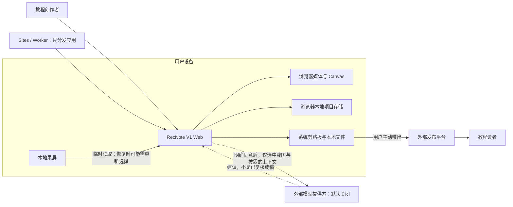
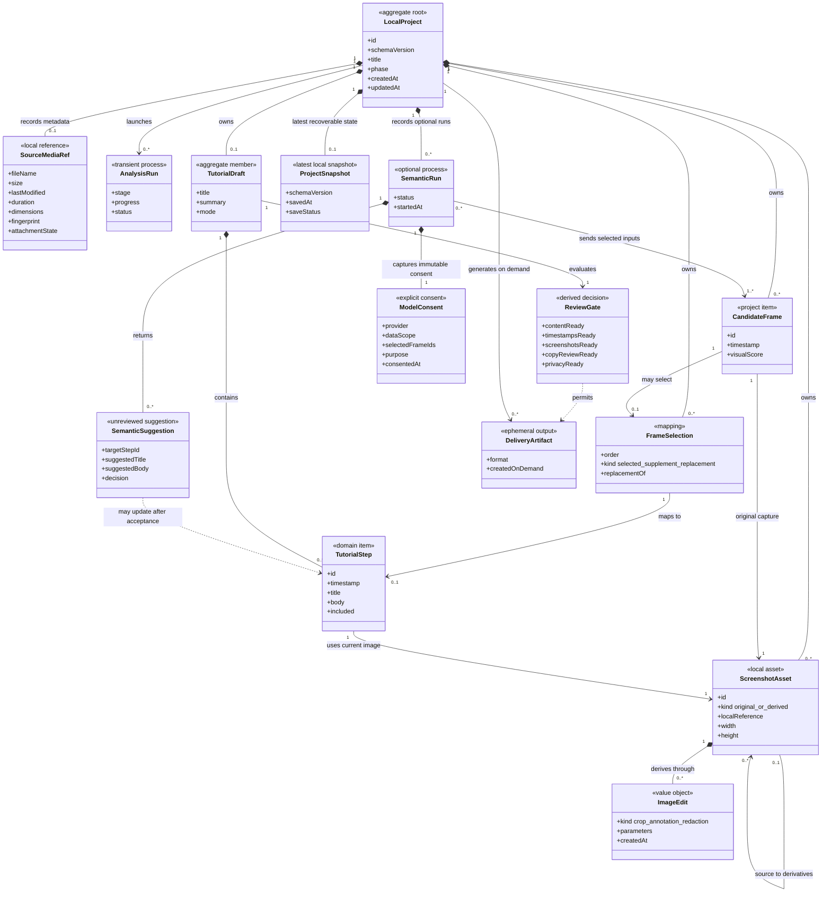
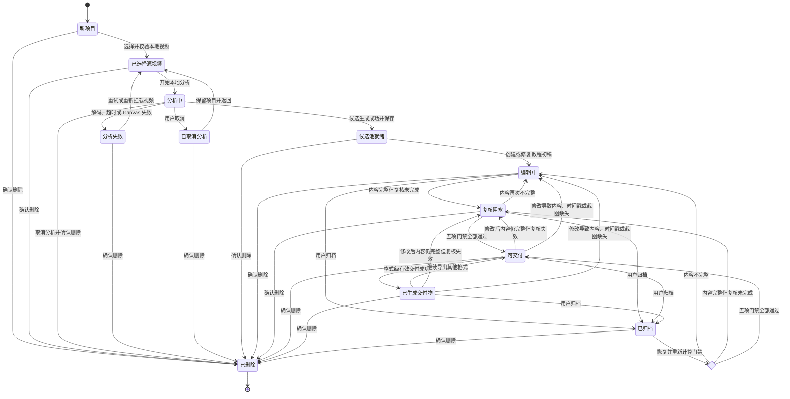
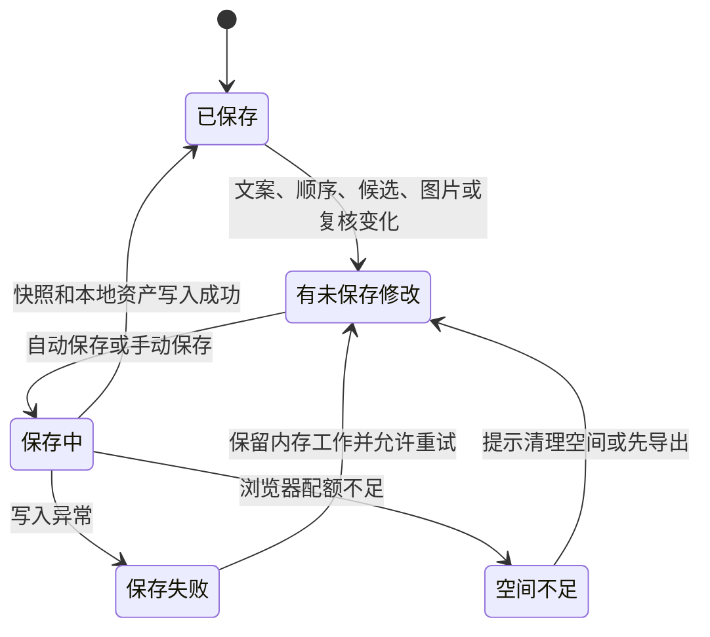
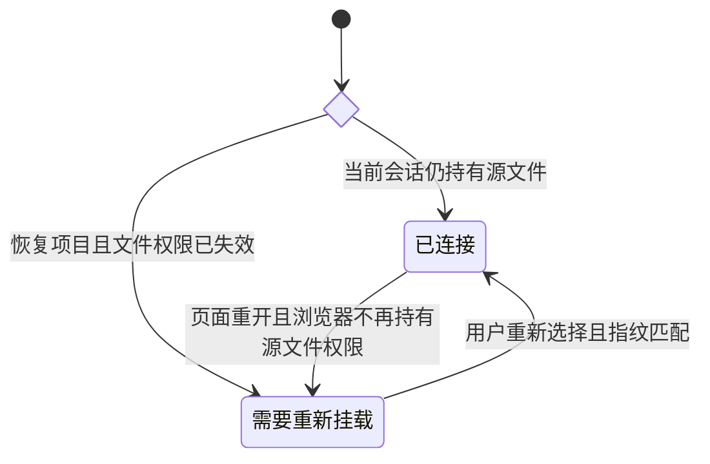
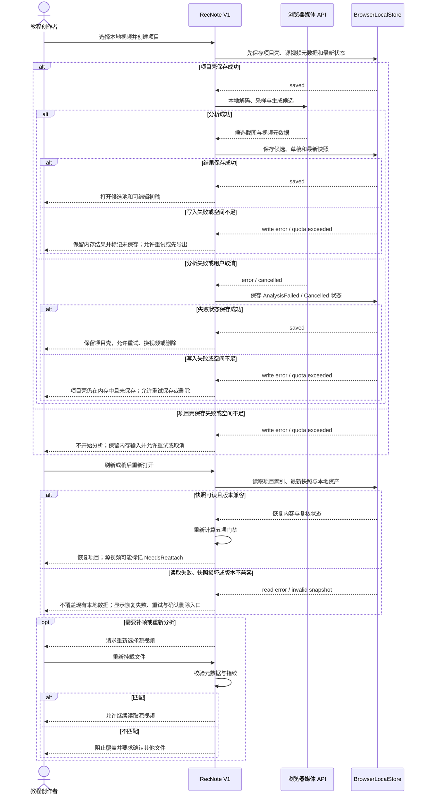
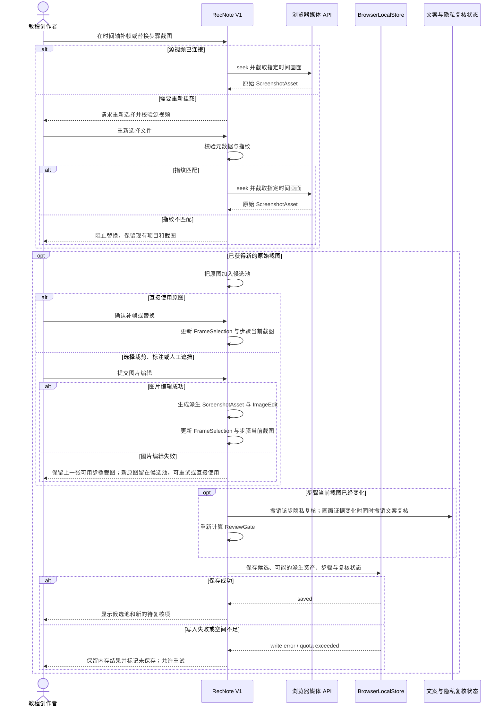
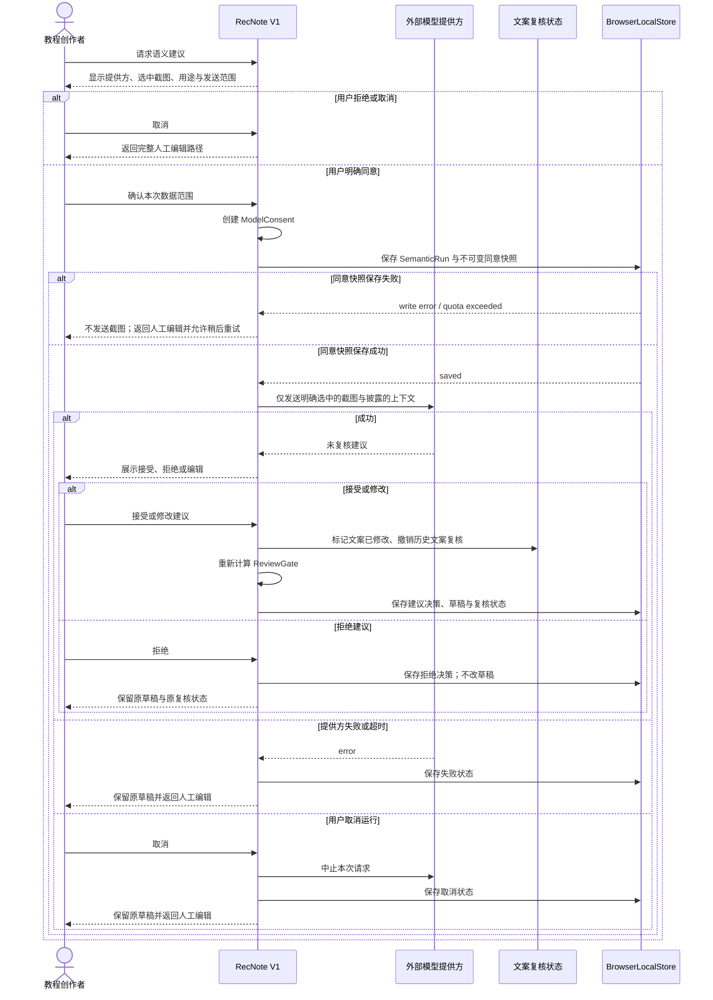

# V1 To-Be 产品蓝图

本文描述录见下一阶段的**待验证目标产品**，不是当前实现、开发承诺、上线日期或已经批准的排期。当前 MVP 和用户研究先按[产品验证指标与决策规则](10-product-validation-metrics.md)收集证据；目标能力只有在能够解释主要失败原因时才进入开发，验证所必需的能力也只能先做成有边界的实验切片。

当前 `0.2.x` 事实仍以 `01`–`09` 为准。本文中的 `To-Be` 对象和状态不得被引用为“已经支持”。

## 目标结论

V1 候选方向收敛为：

> 面向高频个体软件教程创作者的匿名、单人、浏览器本地项目制工具。它首先解决草稿可恢复、候选漏帧可补救、截图可处理和完整交付；AI 建议是默认关闭的可选支路，不是主链硬依赖。

这意味着 V1 不是团队 SaaS，也不以账号、云同步、计费或服务端视频处理作为前置条件。

## 目标范围与决策状态

| 能力 | V1 候选优先级 | 进入目标蓝图的原因 | 决策状态 |
| --- | --- | --- | --- |
| 本地项目列表与最新自动保存 | P0 | 当前真实视频刷新即丢失，是高风险中断点 | 待验证目标 |
| 恢复项目与重新挂载源视频 | P0 | 保存文字和截图不等于持续持有原始视频权限 | 待验证目标 |
| 候选池、按时间补帧、删除与替换截图 | P0 | 当前漏掉关键步骤后没有产品内恢复 | 待验证目标 |
| 裁剪、简单标注和人工遮挡 / 模糊 | P0 | 让候选画面真正可用于教程与隐私处理 | 待验证目标 |
| 当前编辑、复核、五项门禁与三种导出 | P0 | 保留已实现并经工程验收的交付闭环 | 延续当前能力 |
| 可选语义建议 | P1 独立实验 | 人工补全文案仍是核心成本，但模型不能成为主链依赖 | 默认关闭、需单独验证，不属于最小 V1 P0 |
| 账号、组织、团队权限、审批与计费 | 不进入 V1 | 尚无验证证据，会改变产品与部署复杂度 | 未定义 |
| 云同步、云数据库、对象存储与分享链接 | 不进入 V1 | 与本地优先承诺和首轮 ICP 不匹配 | 未定义 |
| 服务端 ffmpeg、任务队列与默认视频上传 | 不进入 V1 | 当前没有必要，也会扩大隐私边界 | 未定义 |

## 目标参与者

| 参与者 | V1 责任 | 边界 |
| --- | --- | --- |
| 教程创作者 | 创建和恢复本地项目、整理候选、编辑截图和文案、完成复核并导出 | 唯一系统内主角色；匿名、单人 |
| 文案审核者、隐私审核者、发布者 | 创作者承担的三种责任侧面 | V1 不创建独立账号或权限角色 |
| 模型提供方 | 在用户明确启用时接收被选中的候选截图并返回建议 | 外部、可选、默认关闭 |
| 外部发布平台 | 接收用户主动粘贴、上传或导入的交付物 | RecNote 不直接发布，也不观测发布结果 |
| 教程读者 | 使用外部平台上的最终教程 | 系统外部角色 |
| CLI 使用者 | 继续使用独立离线候选工具 | 不进入 Web V1 主链，也不与 Web 项目自动互通 |

## 目标核心用例

| 编号 | 用例 | V1 目标结果 | 主要失败与恢复 |
| --- | --- | --- | --- |
| `TU-01` | 创建本地项目 | 从有效录屏得到候选池和可编辑初稿，并保存最新快照 | 解码或分析失败时保留项目壳，允许重试或换视频 |
| `TU-02` | 恢复本地项目 | 恢复文字、候选截图、复核状态和最近编辑位置 | 原视频不可继续访问时进入“需要重新挂载”，不丢失已有成果 |
| `TU-03` | 管理本地项目 | 列出、重命名、继续和删除本机项目 | 删除必须二次确认；V1 不承诺版本树和跨设备恢复 |
| `TU-04` | 修复候选池 | 按时间补帧、删除候选、恢复候选或替换步骤截图 | 需要重新读取视频时要求重新挂载并核对指纹 |
| `TU-05` | 编辑截图 | 裁剪、简单标注和人工遮挡 / 模糊，保留原图与派生图关系 | 编辑失败回到上一张可用图片，不破坏原图 |
| `TU-06` | 编辑与复核教程 | 延续标题、摘要、步骤、顺序、纳入状态与五项门禁 | 修改文案或图片时按规则撤销历史复核 |
| `TU-07` | 获取可选语义建议 | 披露提供方与数据范围，明确同意后只发送选中截图，用户决定接受、拒绝或修改 | 拒绝、失败、取消或超时都回到完整人工路径 |
| `TU-08` | 导出教程 | 按格式级口径生成 Markdown、富文本或完整 ZIP | 失败不改变最近已保存项目，允许重试 |

## 目标系统上下文辅助图

这张图用于表达目标边界，不是标准 UML 系统上下文图。虚线表示只有用户明确启用后才存在的数据路径。

目标部署仍然没有 D1、R2、RecNote 自有的原视频上传 API 或服务端 ffmpeg。只有用户明确启用可选语义建议时，浏览器才按本次同意范围把选中截图直接发送给已披露的外部模型提供方。浏览器本地项目存储可以由 IndexedDB、OPFS 或其他浏览器能力实现，具体技术必须通过 ADR 决定；领域模型只依赖抽象的 `BrowserLocalStore`。

## 目标领域类图

这是 V1 候选范围的标准 UML 类图。它与[当前产品领域模型](08-product-domain-model.md)分开，不能用于声称现有代码已经实现这些对象。

### 领域不变量

1. `LocalProject` 是候选映射、所有本地截图资产和可选语义运行记录的生命周期所有者；删除项目时，其快照、候选、原始截图副本、派生截图、`SemanticRun`、同意快照和建议一并删除，源视频文件本身不复制进项目存储。
2. `SourceMediaRef` 只保存元数据、指纹和可选本地引用；浏览器不再拥有文件权限时必须进入 `NeedsReattach`。
3. 空项目壳可以暂时没有 `TutorialDraft`；分析生成候选或用户主动进入人工建稿后才创建草稿。草稿在选中第一张候选前可以没有步骤，但有效交付至少需要一个被纳入的完整步骤。
4. V1 只承诺“最新可恢复快照”，不承诺版本树、分支或回滚。
5. 每个 `TutorialStep` 使用一张当前截图；替换、裁剪、标注或遮挡必须至少撤销该步隐私复核。
6. 接受 AI 建议等同于修改草稿，必须撤销对应文案复核；建议不能直接成为已复核成稿。
7. 每次 `SemanticRun` 必须保存一份不可变 `ModelConsent` 快照，绑定提供方、被选中的候选 ID、数据范围、用途和同意时间；再次请求建议需要新的本次范围，不能沿用一次同意无限扩大到其他视频或截图。
8. `ReviewGate` 仍是派生决策，不能被用户或模型直接写成通过。
9. `DeliveryArtifact` 按需生成；V1 不保存外部发布结果，也不把导出成功称为已经发布。

## 目标项目生命周期

这是标准 UML 状态机。`phase` 可以保存在最新快照中，但恢复时必须根据草稿内容与门禁重新校验，不能盲信历史 `Ready`。

## 本地保存状态机

保存失败不得让内存中的编辑结果消失，也不得显示虚假的“已保存”。

## 源视频连接状态机

项目处于 `NeedsReattach` 时仍可编辑已有文字和截图、完成复核或导出；只有重新分析、按时间补帧或从源视频替换截图时才必须重新挂载。

## 新建、保存与恢复时序

## 候选修复与截图编辑时序

## 可选 AI 建议时序

这条序列是条件性目标，不属于默认人工主链。

## V1 明确排除

- `User`、`Organization`、`Workspace`、登录、RBAC、多人协作和审批流；
- `Plan`、`Subscription`、`Entitlement`、支付、套餐和用量计费；
- 云端数据库、对象存储、云同步、跨设备项目和分享链接；
- 直连公众号或知识库发布、发布记录、阅读分析与读者埋点；
- 服务端 ffmpeg、后台队列、默认上传原视频；
- 自动隐私识别、自动合规认证或无需人工确认的自动发布；
- 完整版本树、分支和回滚；V1 只承诺本地项目列表与最新快照；
- Docker 自托管、原生桌面或移动端、长视频、会议转写和通用视频摘要。

## 进入开发前的门槛

1. [产品验证指标与决策规则](10-product-validation-metrics.md)达到对应 Go 或明确的 Iterate 条件；`Go` 才授权完整 P0 产品化，`Iterate` 只授权针对失败原因的有边界实验。
2. 为本地项目存储、浏览器配额、源视频重新挂载和删除语义完成 ADR。
3. 明确 P0 只包含本地项目、候选修复、基础截图处理和现有交付闭环；可选模型链单独估算、单独启用、单独验收。
4. 为每项新增能力补充业务规则 ID、异常路径、隐私说明和自动化验收，再把它从本文迁入当前实现文档。
