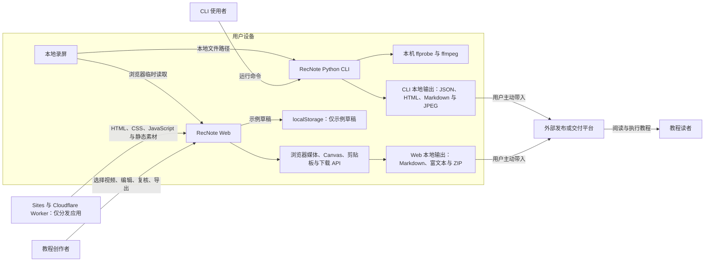
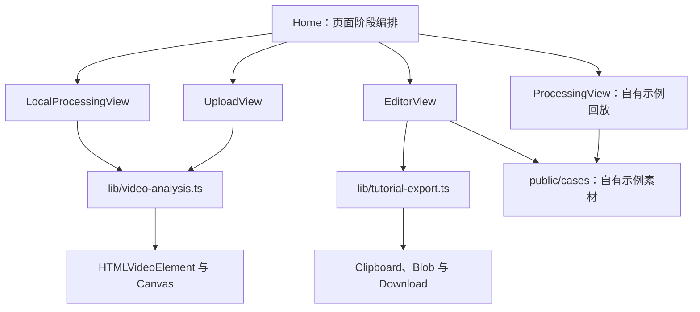

# 录见 UML 与架构文档

本目录从产品与工程两个层次描述录见 RecNote `0.2.x` 的**当前能力基线**。图表使用 GitHub 原生支持的 Mermaid，便于产品、设计、测试和研发在 Pull Request 中审查同一套事实。

## 先读结论

- Web 与 CLI 是两条彼此独立的本地处理链路，Web 不会调用 Python CLI。
- Web 使用 `HTMLVideoElement` 与 Canvas 在浏览器内分析视频；当前没有视频上传接口、媒体处理服务器或数据库。
- CLI 使用本机 Python、`ffprobe` 与 `ffmpeg`，产物只写入用户指定的本地目录。
- 当前没有接入大模型、自动语义理解、自动隐私识别或自动打码。
- 只有自有示例草稿会写入 `localStorage`；真实视频、候选截图和真实视频草稿只存在于当前浏览器会话。

这些边界是架构约束，不是省略的实现细节。未来能力在真正落地前不应画入“当前实现”图。

## 产品定义

录见解决的不是“把视频总结成一段话”，而是减少用户在录屏结束后重新拖动时间轴、截图、排序、补说明和检查隐私的重复劳动。

当前 Web 产品的业务边界是：

```text
已经录好的短软件录屏
  → 浏览器本地筛选候选画面
  → 人工补全并组织教程步骤
  → 人工复核文字与截图隐私
  → 生成可继续发布的 Markdown、富文本或 ZIP
```

录屏工具、最终发布平台和教程阅读体验都在系统边界之外。CLI 是高级用户与工程验证的独立辅助路径，不是 Web 主旅程的后台处理器。

### 利益相关者

| 角色 | 当前状态 | 目标或责任 |
| --- | --- | --- |
| 教程创作者 | 当前主要产品用户 | 提供录屏，整理步骤，完成复核并导出 |
| 文案审核者、隐私审核者、发布者 | 当前与创作者是同一个匿名用户 | 分别核对准确性、隐私和最终交付；当前没有权限分离 |
| 教程读者 | 系统外部角色 | 使用最终教程完成任务；当前产品无法观测其结果 |
| CLI 使用者 | 当前高级路径 | 在本机获得可复现候选和离线评审产物 |
| 项目维护者 | 工程角色，不是产品客户 | 维护代码、规则、测试和文档 |
| 购买决策者 | 尚未验证 | 可能是个体创作者，或培训、客户成功、产品运营团队负责人 |
| 企业 IT / 安全管理员 | 未来假设 | 只有进入私有部署、模型治理或团队权限场景后才成为系统角色 |

仓库目前没有账号、组织、套餐、计费或采购对象。因此“谁付钱”只能作为商业验证假设，不能画成当前系统事实：

1. 最易触达的是需要频繁制作软件教程的个体创作者、产品经理、培训师和实施顾问；使用者与购买者可能是同一人。
2. 更可能形成复购的是教程数量多、软件更新频繁的 SaaS 客户成功、产品运营或课程团队；使用者与预算方可能分离。
3. 企业培训与 SOP 的价值可能更高，但会增加权限、部署、数据治理和采购周期，暂不属于 `0.2.x` 范围。

### 场景优先级假设

| 场景 | 用户问题 | 当前适配度 | 验证重点 |
| --- | --- | --- | --- |
| 软件操作教程、产品演示 | 录完后仍要手工找截图、排序和补说明 | 高；当前 MVP 直接覆盖 | 时间节省、关键步骤遗漏、人工重写量 |
| 培训师与课程团队 | 同类课程需要持续生产图文配套材料 | 中；流程可用，尚无项目历史 | 重复使用频率、模板与版本需求 |
| SaaS 客户成功、产品运营 | 功能更新频繁，帮助文档需要同步维护 | 中；缺少旧教程更新和团队协作 | 复购、更新成本、多人审核 |
| 企业 SOP 与内部培训 | 隐私与部署要求高，审核链更长 | 低；当前没有权限、自托管或治理能力 | 安全要求、采购角色、部署方式 |

当前非目标场景包括会议转写、访谈摘要、影视剪辑、音频内容整理和通用长视频总结。录见的输入重点是软件界面操作，输出重点是别人可以照着完成的步骤化图文教程。

### 产品成功定义

| 层级 | 定义 | 当前能否观测 |
| --- | --- | --- |
| 激活 | 首次进入可编辑候选初稿 | 页面状态可判断，当前未埋点 |
| 核心成功 | 五项门禁通过，并至少成功复制或下载一种交付物 | 当前会话可判断，当前未埋点 |
| 用户价值 | 相比手工流程减少整理时间，同时不增加关键步骤遗漏和隐私风险 | 需要脱敏样本和人工对照验证 |
| 业务价值 | 用户持续使用，并愿意为节省的时间、团队协作或部署治理付费 | 尚未验证 |
| 外部结果 | 教程真正发布，且读者可以照着完成任务 | 当前系统无法观测 |

建议优先验证：首次初稿时间、候选隐藏率、缺失步骤数、文案重写率、从初稿到就绪的人工时间、有效导出率和相对手工流程节省的时间。当前没有产品分析 SDK，这些指标应先通过自愿参与的用户研究收集。

### 版本范围

| 项目 | 当前基线 |
| --- | --- |
| 产品版本 | `0.2.x` |
| 示例草稿 schema | `version = 2` |
| CLI 输出 schema | `1.0` |
| D1 / R2 | 均未配置 |
| 覆盖范围 | RecNote 主入口、本地 Web 流程和独立 CLI |
| 排除范围 | 木瓦任务板案例应用、公众号文章脚本、传播素材和外部发布平台 |

## 文档索引

| 文档 | 回答的问题 | 主要依据 |
| --- | --- | --- |
| [用例说明](01-use-cases.md) | 谁在什么条件下完成哪些任务？ | `app/page.tsx`、`cli/video_guide.py` |
| [Web 数据模型](02-web-data-model.md) | 视频结果、教程步骤、草稿与导出对象如何关联？ | `lib/video-analysis.ts`、`app/page.tsx`、`lib/tutorial-export.ts` |
| [Web 状态机](03-web-state-machines.md) | 页面、分析与复核状态如何转换？ | `app/page.tsx`、`lib/video-analysis.ts` |
| [Web 时序图](04-web-sequences.md) | 本地分析、编辑复核、导出与草稿恢复怎样协作？ | `app/page.tsx`、`lib/tutorial-export.ts` |
| [CLI 管线](05-cli-pipeline.md) | Python、ffprobe、ffmpeg 和本地文件系统如何协作？ | `cli/video_guide.py` |
| [部署与隐私边界](06-deployment-and-privacy.md) | 代码在哪里运行，数据在哪里停留？ | `.openai/hosting.json`、`vite.config.ts`、`PRIVACY.md` |
| [产品活动与用户旅程](07-product-activities-and-journeys.md) | 用户如何从录屏走到有效交付，失败时怎样恢复？ | 产品用例、页面行为、E2E 测试 |
| [产品领域模型](08-product-domain-model.md) | 产品在管理哪些业务概念，哪些对象当前仍缺失？ | 当前数据结构、状态与产品边界 |
| [业务规则与需求追踪](09-business-rules-and-traceability.md) | 哪些规则必须成立，需求怎样追溯到状态、时序和测试？ | 源码、隐私说明、CLI 与 E2E 测试 |

## 推荐阅读路径

- 产品经理：本页 → [用例说明](01-use-cases.md) → [产品活动与用户旅程](07-product-activities-and-journeys.md) → [产品领域模型](08-product-domain-model.md) → [Web 状态机](03-web-state-machines.md) → [业务规则与需求追踪](09-business-rules-and-traceability.md)
- 设计与测试：[产品活动与用户旅程](07-product-activities-and-journeys.md) → [Web 状态机](03-web-state-machines.md) → [业务规则与需求追踪](09-business-rules-and-traceability.md) → [Web 时序图](04-web-sequences.md)
- 开发者：[Web 数据模型](02-web-data-model.md) → [Web 时序图](04-web-sequences.md) → [CLI 管线](05-cli-pipeline.md) → [部署与隐私边界](06-deployment-and-privacy.md)

## 系统上下文辅助图

下面是运行边界辅助图，帮助先建立整体认识。Mermaid 没有标准 UML 系统上下文语法，因此这张图是架构辅助图，不冒充 UML 图。



Web 与 CLI 之间没有运行时连线；两者只是共享同一个仓库和“从录屏提取候选画面”的产品目标。外部平台和读者位于系统边界之外，录见当前只知道交付物是否生成成功，不知道是否真正发布或被成功执行。

本文档只覆盖 RecNote 主入口及其 Web / CLI 教程生成链路。`/cases/muwa-board` 等自有案例应用、公众号文章与传播素材路由属于演示内容，不纳入主系统 UML；它们被引用时只视为受控示例素材。

## Web 模块依赖辅助图

这张图使用流程图表达模块依赖，不是标准 UML 组件图。



## 运行与部署边界

应用分发、浏览器本地处理、CLI 本机处理、草稿持久化和明确不存在的服务端节点，统一见[部署与隐私边界](06-deployment-and-privacy.md)。核心约束是：托管层只分发应用，Web 与 CLI 都在用户设备上处理媒体，D1 与 R2 当前均未配置。

## 图表约定

- `classDiagram` 中的“类”多数对应 TypeScript `type` 或 Python `dataclass`，不代表代码一定采用面向对象运行时模型。
- [产品领域模型](08-product-domain-model.md) 中的类是业务概念，不要求源码存在同名类，也不代表数据库表。
- Mermaid 的 `flowchart` 只作为产品上下文、活动、模块依赖和部署辅助图；标准 UML 图只使用 `classDiagram`、`stateDiagram-v2` 与 `sequenceDiagram`。
- 实线只表示当前代码中存在的关系；文档不把路线图能力画成已完成组件。
- 页面发布门禁由五个并行布尔条件共同决定，不强行伪装成单线状态机。
- 公众号文章中的 PNG / SVG 是传播素材，不是本目录 UML 的工程事实来源。

## 维护规则

影响下列任一内容的代码变更，必须同步更新相应文档：

- 公共数据结构或导出格式；
- 页面、分析或复核状态；
- Web 与 CLI 的模块边界；
- 视频、截图和草稿的持久化方式；
- 产品领域概念、核心旅程或稳定业务规则；
- 网络、模型、D1、R2 或服务端处理能力。

如果图与代码不一致，应把它视为文档缺陷并在同一个 Pull Request 中修正。
