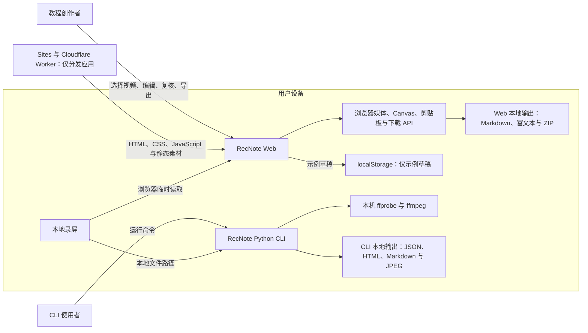
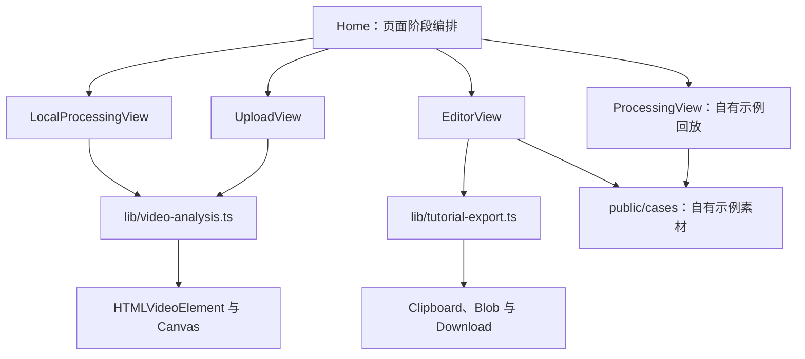

# 录见 UML 与架构文档

本目录描述录见 RecNote `0.2.x` 的**当前实现**。图表使用 GitHub 原生支持的 Mermaid，便于在 Pull Request 中随代码一起审查。

## 先读结论

- Web 与 CLI 是两条彼此独立的本地处理链路，Web 不会调用 Python CLI。
- Web 使用 `HTMLVideoElement` 与 Canvas 在浏览器内分析视频；当前没有视频上传接口、媒体处理服务器或数据库。
- CLI 使用本机 Python、`ffprobe` 与 `ffmpeg`，产物只写入用户指定的本地目录。
- 当前没有接入大模型、自动语义理解、自动隐私识别或自动打码。
- 只有自有示例草稿会写入 `localStorage`；真实视频、候选截图和真实视频草稿只存在于当前浏览器会话。

这些边界是架构约束，不是省略的实现细节。未来能力在真正落地前不应画入“当前实现”图。

## 文档索引

| 文档 | 回答的问题 | 主要源码 |
| --- | --- | --- |
| [用例说明](01-use-cases.md) | 谁在什么条件下完成哪些任务？ | `app/page.tsx`、`cli/video_guide.py` |
| [Web 数据模型](02-web-data-model.md) | 视频结果、教程步骤、草稿与导出对象如何关联？ | `lib/video-analysis.ts`、`app/page.tsx`、`lib/tutorial-export.ts` |
| [Web 状态机](03-web-state-machines.md) | 页面、分析与复核状态如何转换？ | `app/page.tsx`、`lib/video-analysis.ts` |
| [Web 时序图](04-web-sequences.md) | 本地分析、编辑复核、导出与草稿恢复怎样协作？ | `app/page.tsx`、`lib/tutorial-export.ts` |
| [CLI 管线](05-cli-pipeline.md) | Python、ffprobe、ffmpeg 和本地文件系统如何协作？ | `cli/video_guide.py` |
| [部署与隐私边界](06-deployment-and-privacy.md) | 代码在哪里运行，数据在哪里停留？ | `.openai/hosting.json`、`vite.config.ts`、`PRIVACY.md` |

## 系统上下文辅助图

下面是运行边界辅助图，帮助先建立整体认识。Mermaid 没有标准 UML 系统上下文语法，因此这张图是架构辅助图，不冒充 UML 图。

Web 与 CLI 之间没有运行时连线；两者只是共享同一个仓库和“从录屏提取候选画面”的产品目标。

本文档只覆盖 RecNote 主入口及其 Web / CLI 教程生成链路。`/cases/muwa-board` 等自有案例应用、公众号文章与传播素材路由属于演示内容，不纳入主系统 UML；它们被引用时只视为受控示例素材。

## Web 模块依赖辅助图

这张图使用流程图表达模块依赖，不是标准 UML 组件图。

## 运行与部署边界

应用分发、浏览器本地处理、CLI 本机处理、草稿持久化和明确不存在的服务端节点，统一见[部署与隐私边界](06-deployment-and-privacy.md)。核心约束是：托管层只分发应用，Web 与 CLI 都在用户设备上处理媒体，D1 与 R2 当前均未配置。

## 图表约定

- `classDiagram` 中的“类”多数对应 TypeScript `type` 或 Python `dataclass`，不代表代码一定采用面向对象运行时模型。
- 实线只表示当前代码中存在的关系；文档不把路线图能力画成已完成组件。
- 页面发布门禁由五个并行布尔条件共同决定，不强行伪装成单线状态机。
- 公众号文章中的 PNG / SVG 是传播素材，不是本目录 UML 的工程事实来源。

## 维护规则

影响下列任一内容的代码变更，必须同步更新相应文档：

- 公共数据结构或导出格式；
- 页面、分析或复核状态；
- Web 与 CLI 的模块边界；
- 视频、截图和草稿的持久化方式；
- 网络、模型、D1、R2 或服务端处理能力。

如果图与代码不一致，应把它视为文档缺陷并在同一个 Pull Request 中修正。
