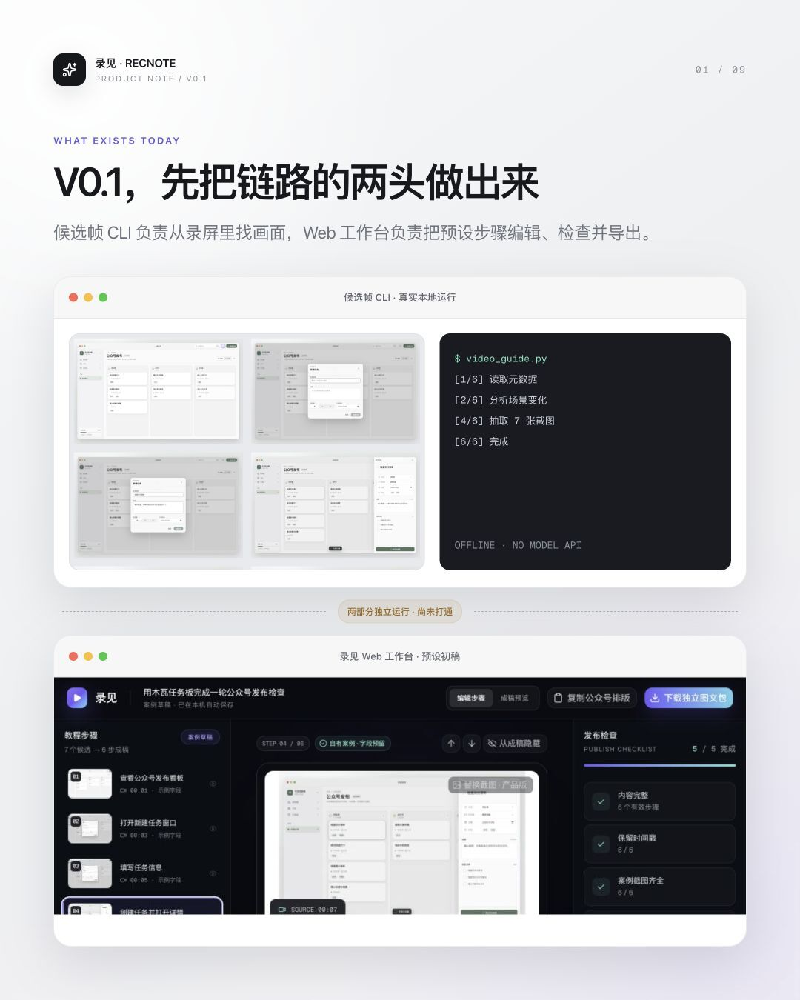
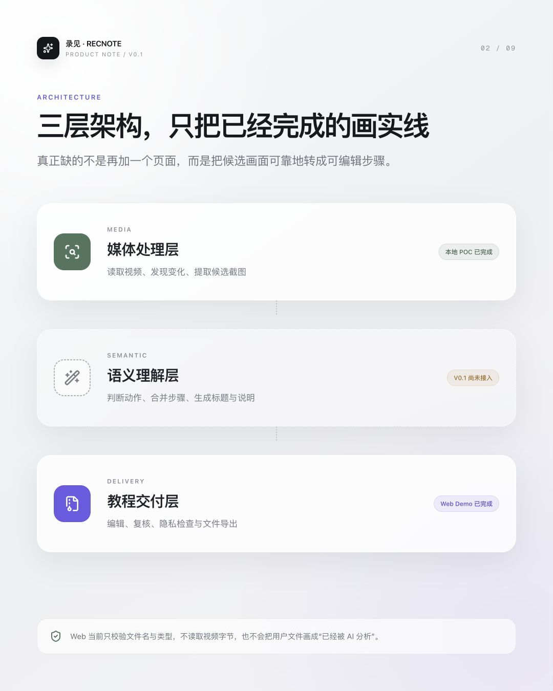
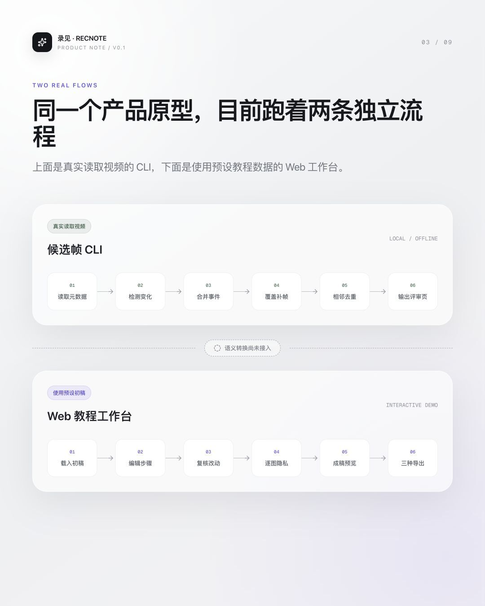
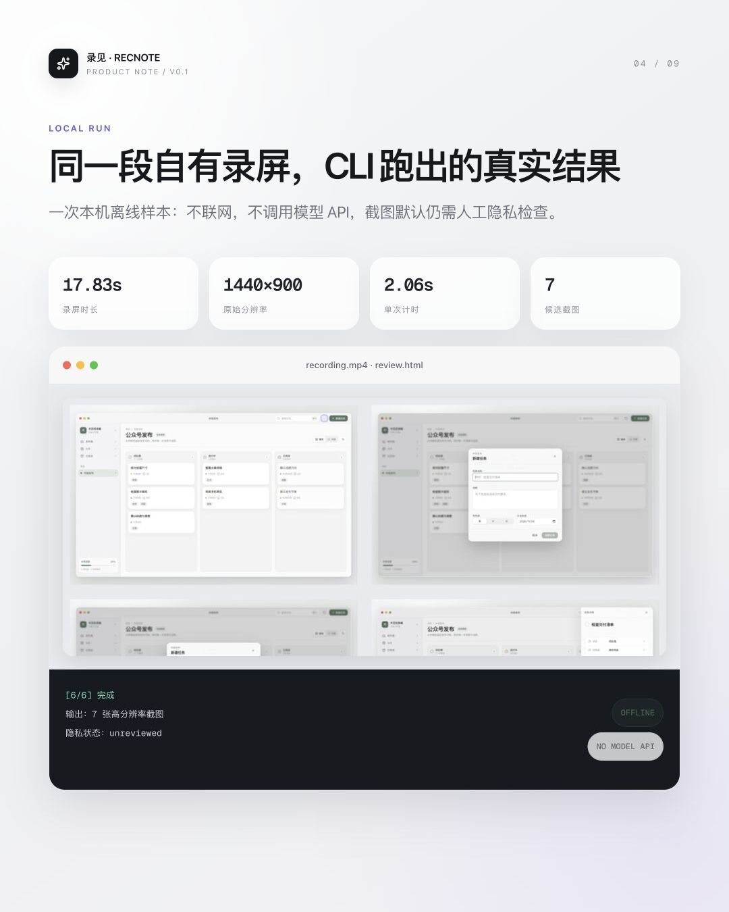
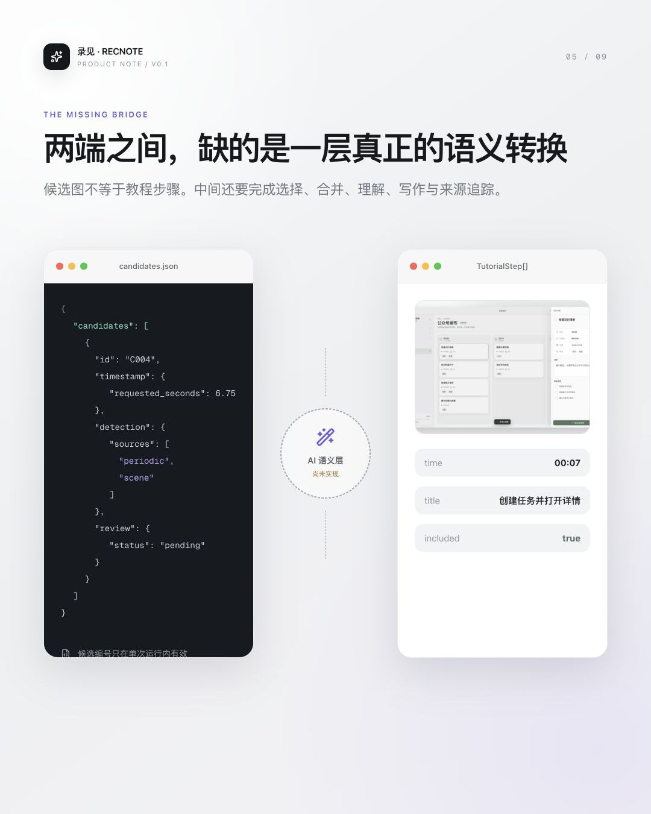
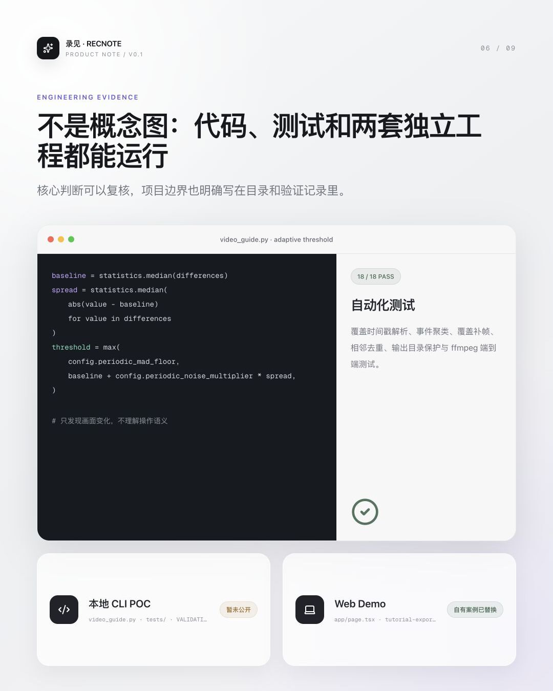
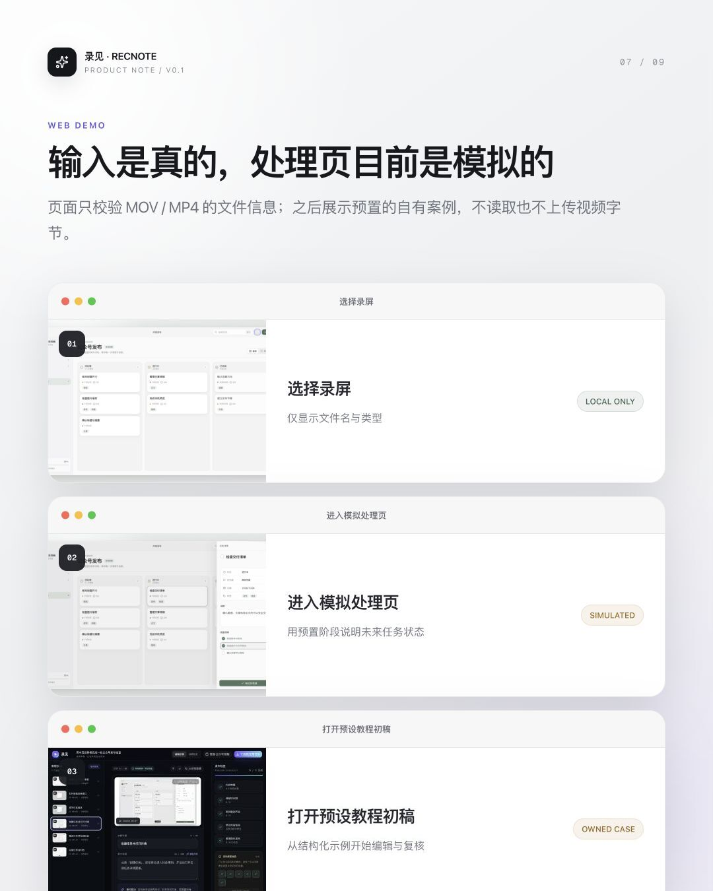
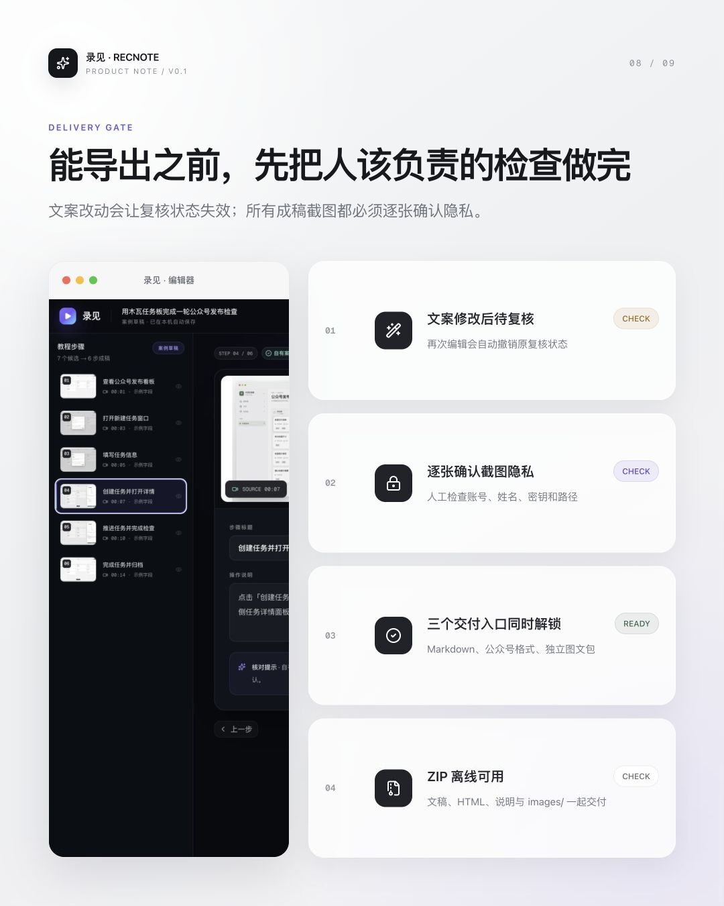
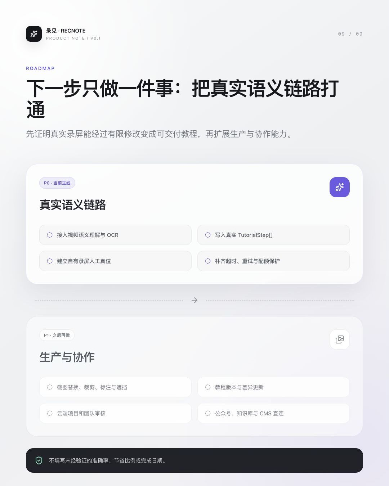

# 最近我在做一个「录屏转图文」工具：18 秒录屏，挑出 7 张关键画面

最近我在做一个东西，叫「录见」。

操作过程明明已经录下来了，为什么写教程时还要再做一遍？

拖进度条、找截图、排步骤、补说明……如果要对外发布，还得逐张检查画面里有没有账号、姓名和其他隐私信息。

我想让录见把这段重复工作接过去：从录屏里找到关键画面，整理成步骤，再交给人编辑、检查和导出。

先不讲设想，看看 V0.1 已经跑起来的部分。



现在的 V0.1，先把这件事的两头做出来了。

一头是候选帧 CLI。它会在本机读取视频，从时间轴里挑出值得人工检查的画面，并生成一份离线评审页。

另一头是 Web 教程工作台。它从预设的结构化初稿开始，验证步骤编辑、文案复核、截图隐私确认和文件导出。

这两部分目前可以分别运行。负责“看懂用户做了什么，再把操作写成教程”的 AI 语义层还没有接入，所以它们尚未串成一条自动流水线。

下面，我从整体架构、处理流程、数据结构、核心实现和产品页面几个部分，把这次实现完整拆开。

## 一、项目整体说明

### 1.1 整体架构

录见的输入是一段软件操作录屏，目标输出是一份可以继续编辑、逐图检查并导出的图文教程。

为此，我把整条链路拆成三个部分：

1. **媒体处理层**：读取视频信息，发现画面变化，提取候选截图。目前已经完成本地 POC。
2. **语义理解层**：判断用户做了什么，合并连续动作，生成步骤标题和说明。目前尚未接入。
3. **教程交付层**：编辑步骤、复核文案、检查截图隐私并导出文件。目前已经完成 Web Demo。



当前候选帧 CLI 与 Web 工作台可以分别运行，但两端尚未通过语义层连接。Web 读取的是预设教程数据，不是 CLI 的真实输出。

### 1.2 当前处理流程

候选帧 CLI 走的是一条真实的本地媒体处理流程：读取视频元数据，检测场景变化和周期灰度差异，合并临近事件，补充时间覆盖候选，去除相邻重复画面，最后输出截图、JSON 清单和离线评审页。

Web Demo 走的是另一条独立流程：载入预设教程初稿，修改标题和步骤说明，调整顺序或隐藏无效步骤，重新复核改过的文案，逐张确认成稿截图，再预览和导出。



CLI 不调用网络或模型 API。每张候选截图默认都标记为“待人工检查”；程序会给出提醒，但不会自动拦截未经检查的图片。

Web 首页目前只校验文件类型并显示文件名，不读取视频字节，也不会上传或分析用户选择的视频。页面中的处理进度和教程初稿均为预设内容。

这次我使用的是木瓦任务板自有案例。录屏时长 17.83 秒，30 fps，分辨率 1440 × 900；在这台 Mac 上单次计时为 2.06 秒，输出 7 张候选截图。这个数字只是本机单次样本，不是性能基准。

为了缩短这段短录屏的覆盖间隔，这次运行显式使用了 `--coverage-interval 2.5 --max-candidates 20`，而不是完全照搬默认参数。完整命令、输入文件哈希和环境信息已记录在项目的 `docs/木瓦任务板-CLI验证记录.md` 中。



### 1.3 两端的数据结构

为了让两端以后能够连接，V0.1 先明确了输入和输出的数据结构。

| 数据对象                    | 当前来源     | 主要字段                                   | 用途                     |
| --------------------------- | ------------ | ------------------------------------------ | ------------------------ |
| `candidates[]` 中的候选记录 | 候选帧 CLI   | 编号、时间戳、截图、检测信号、人工评审状态 | 保存值得进一步判断的画面 |
| `TutorialStep`              | Web 预设数据 | 编号、时间、标题、正文、截图、是否纳入成稿 | 驱动教程编辑、审核与导出 |

其中，候选编号只在单次运行内按顺序生成；候选集合发生变化后，编号也可能改变。Web 中的 `confidence` 只是预留的展示字段，目前不是模型置信度。

CLI 会生成 `metadata.json`、`candidates.json`、`review.html`、`model_prompt.md` 和 `screenshots/`。其中，`model_prompt.md` 会提醒使用者：把截图交给后续模型之前，必须先人工检查并移除敏感信息。

两端之间真正需要补上的转换是：

> `candidates[] → TutorialStep[]`

它需要完成候选画面选择、连续动作合并、操作语义理解、步骤文案生成，并保留截图、时间戳和来源之间的关系。



### 1.4 核心实现：代码真正做了什么

#### 1.4.1 候选画面不是固定间隔截图

如果只是每隔几秒截一张图，很容易遇到两个问题：静止页面留下大量重复画面，短暂出现的菜单和弹层却可能刚好被错过。

因此，候选帧 CLI 默认使用两路信号：以 8 fps、640 px 分析较明显的场景变化；以 1 fps、160 px 输出灰度帧，比较相邻画面的平均绝对差异。

周期信号的阈值会根据当前视频自身的基础波动计算：

```python
differences = [
    mean_absolute_difference(
        samples[index - 1].pixels,
        samples[index].pixels,
    )
    for index in range(1, len(samples))
]

baseline = statistics.median(differences)
spread = statistics.median(
    abs(value - baseline) for value in differences
)
threshold = max(
    config.periodic_mad_floor,
    baseline + config.periodic_noise_multiplier * spread,
)
```

这段代码用于计算周期差异的自适应阈值；只有达到阈值、同时构成相邻局部峰值的采样点，才会形成周期信号。它不理解画面对应的操作语义。

默认配置下，程序还会：

- 把 2 秒内的连续信号合并成一个事件；
- 只对包含场景信号的事件增加 0.5 秒稳定延时，周期信号独有的短暂状态保留原始采样时刻；
- 在信号稀疏的区域按最多 5 秒间隔补充覆盖候选；
- 只在 4 秒时间窗口内比较最近候选，同时使用全局差异和 4×4 分块局部差异去重；
- 候选超过 80 张时，在按时间排序的列表中按索引等距保留，而不是按秒数给整条时间轴分桶。

场景检测和周期采样的基础时间戳来自 ffmpeg 输出的 `pts_time`；部分截图时间会在此基础上计算。当前版本尚未回读确认解码器实际取得的帧时间，所以最终时间点仍需人工回看原视频。

目前本地有 18 项自动化测试，覆盖时间戳解析、短暂局部变化保留、事件聚类、覆盖补帧、相邻去重、输出目录保护，以及一个由 ffmpeg 临时生成视频的端到端测试。正式发布 CLI 时会一并附上测试记录。

#### 1.4.2 文案一改，原来的复核状态立即失效

编辑器不会把“复核完成”永久绑定在某个步骤上。用户修改步骤标题或正文时，程序会把它加入已编辑集合，同时从已复核集合中删除：

```tsx
const updateStepCopy = (
  id: number,
  patch: Pick<TutorialStep, 'title'> | Pick<TutorialStep, 'body'>,
) => {
  updateStep(id, patch);
  setEditedStepIds((current) => new Set(current).add(id));
  setReviewedStepIds((current) => {
    const next = new Set(current);
    next.delete(id);
    return next;
  });
};
```

文章标题和摘要使用同样的机制。调整步骤顺序或隐藏步骤不会触发文案重审，但交付门禁会根据当前纳入成稿的步骤重新计算截图、时间戳和隐私检查状态。

#### 1.4.3 三种交付方式共用一道门禁

录见目前提供复制 Markdown、复制公众号格式和下载独立图文包三种交付入口，但它们不会各自维护一套检查逻辑，而是共同经过 `validateDelivery()`：

```tsx
const validateDelivery = () => {
  if (!contentReady) {
    showNotice('请先补全标题、摘要和至少一个有效步骤', 'warning');
    return false;
  }
  if (!timestampsReady || !screenshotsReady) {
    showNotice('时间戳或截图不完整，暂时无法交付', 'warning');
    return false;
  }
  if (!copyReviewReady) {
    showNotice(`还有 ${pendingReviewCount} 项修改待核对`, 'warning');
    return false;
  }
  if (!privacyReady) {
    showNotice(
      `请逐张检查截图隐私（${privacyReviewedCount}/${includedSteps.length}）`,
      'warning',
    );
    return false;
  }
  return true;
};
```

门禁检查五件事：文章内容完整、成稿步骤保留时间戳、成稿步骤具有截图、修改过的文案已经重新复核，以及全部成稿截图都完成人工隐私确认。

这里的隐私确认只是人工状态，程序不会自动识别图片里的账号、姓名或密钥。在不支持富文本剪贴板的浏览器中，公众号格式复制会回退为 Markdown。

#### 1.4.4 ZIP 打包与本地草稿恢复

下载图文包时，程序只处理纳入成稿的步骤，并为截图生成 `images/step-01.jpg` 一类相对路径。压缩包中包含 `教程.md`、`公众号预览.html`、`使用说明.txt` 和 `images/`；解压后，Markdown 和 HTML 不依赖当前页面，也能读取配套图片。

编辑器还会把步骤顺序、标题、正文、隐藏状态、当前步骤、编辑模式、文案复核记录和截图隐私确认记录保存到 `localStorage`。它只能支持同一浏览器、同一站点下继续编辑，不包含账号、云端项目或跨设备同步。

### 1.5 项目结构

两套实现目前位于独立目录。Web 的核心逻辑集中在 `app/page.tsx`，Markdown、公众号 HTML 和 ZIP 导出集中在 `lib/tutorial-export.ts`；本地候选帧 POC 的核心是 `video_guide.py`，并配有独立测试与验证记录。



## 二、产品演示

### 2.1 输入与模拟处理

首页可以选择 MOV 或 MP4，也可以直接进入自有案例。当前文件选择只校验类型并显示文件名；随后出现的处理进度和教程初稿均为前端预设，用来验证未来处理任务的页面状态。



### 2.2 编辑、复核与导出

编辑器真正验证的是一套“可以交付”的机制：文案修改后必须重新复核，纳入成稿的截图必须逐张确认隐私；任一检查未完成，三个交付入口都不会放行。

检查通过后，可以复制 Markdown、复制公众号格式或下载独立图文包。打开图文包后，还可以在离线环境中继续使用文稿和配套截图。



## 三、项目地址与运行方式

### 3.1 项目地址

- 在线 Demo：[https://lujian-video-guide-demo.caiyiwenann.chatgpt.site/](https://lujian-video-guide-demo.caiyiwenann.chatgpt.site/)
- 自有录屏案例：[木瓦任务板](https://lujian-video-guide-demo.caiyiwenann.chatgpt.site/cases/muwa-board)
- Web 源码：[https://github.com/AnnCYW-cm/recnote](https://github.com/AnnCYW-cm/recnote)
- 候选帧 CLI：本地技术 POC，暂未公开

当前 Web 没有业务数据后端。草稿保存在浏览器 `localStorage`，独立图文包也由浏览器在本地生成。

### 3.2 本地启动

Web Demo 需要 Node.js 22.13.0 或更高版本：

```bash
git clone https://github.com/AnnCYW-cm/recnote.git
cd recnote
npm ci
npm run dev
```

启动后访问 `http://localhost:3000/`。提交修改前可以运行：

```bash
npm run check
```

该命令会依次执行格式检查、代码检查、TypeScript 类型检查和生产构建。

## 四、下一步

V0.2 只聚焦一条主线：真正打通 `candidates[] → TutorialStep[] → Web 工作台`。

优先完成四项 P0：

1. 接入视频语义理解与 OCR，把候选画面整理成结构化教程初稿；
2. 将真实结果写入 Web 工作台，保留视频、截图、时间戳和步骤之间的来源关系；
3. 使用自有或已获授权录屏建立人工真值，评测关键步骤召回、截图匹配和人工修订量；
4. 增加任务超时、失败重试、文件大小和磁盘配额等资源保护。

完成这条主线以后，再考虑 P1：截图替换、裁剪、标注与局部遮挡；教程版本与差异更新；云端项目和团队审核；以及公众号、知识库和 CMS 的直连发布。



我不想把录见的判断标准定成“模型能够返回一段内容”。真正的标准是：一段真实录屏，能不能经过有限修改，变成一份可以发布、培训或交付的教程。

如果你也经常把操作录屏整理成教程、SOP 或培训材料，欢迎在评论区告诉我：你最希望录见先替你省掉哪一步——反复回看、找截图、写步骤、排版，还是检查隐私？我会用这些真实场景决定 V0.2 的验证顺序。
