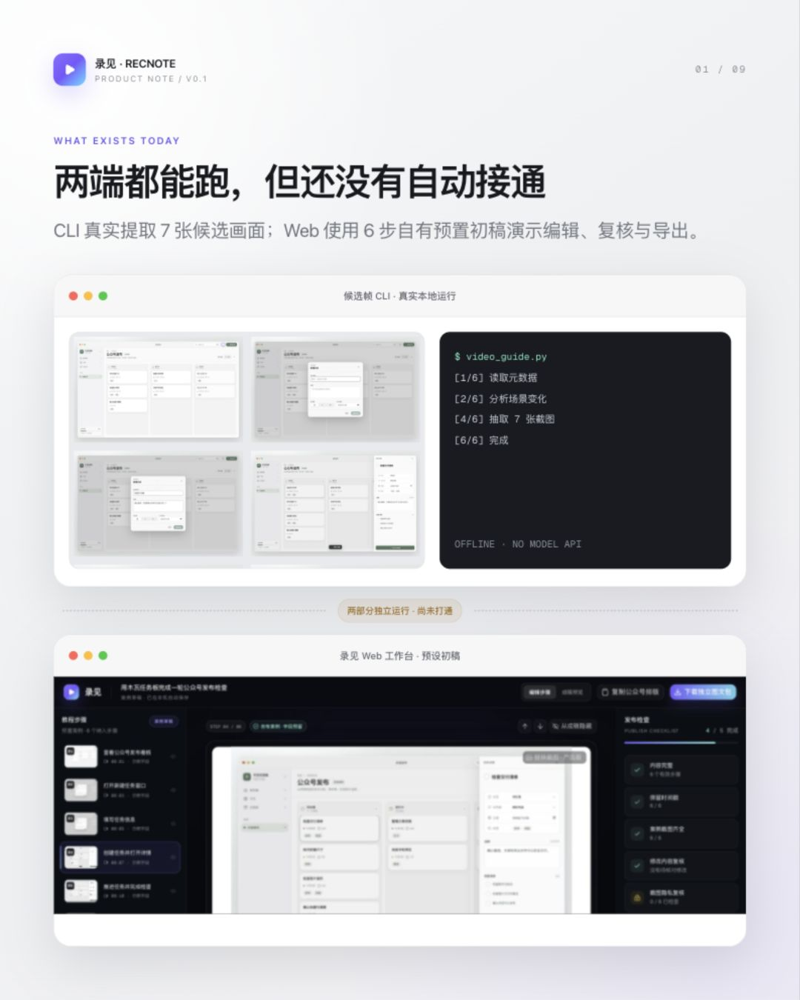
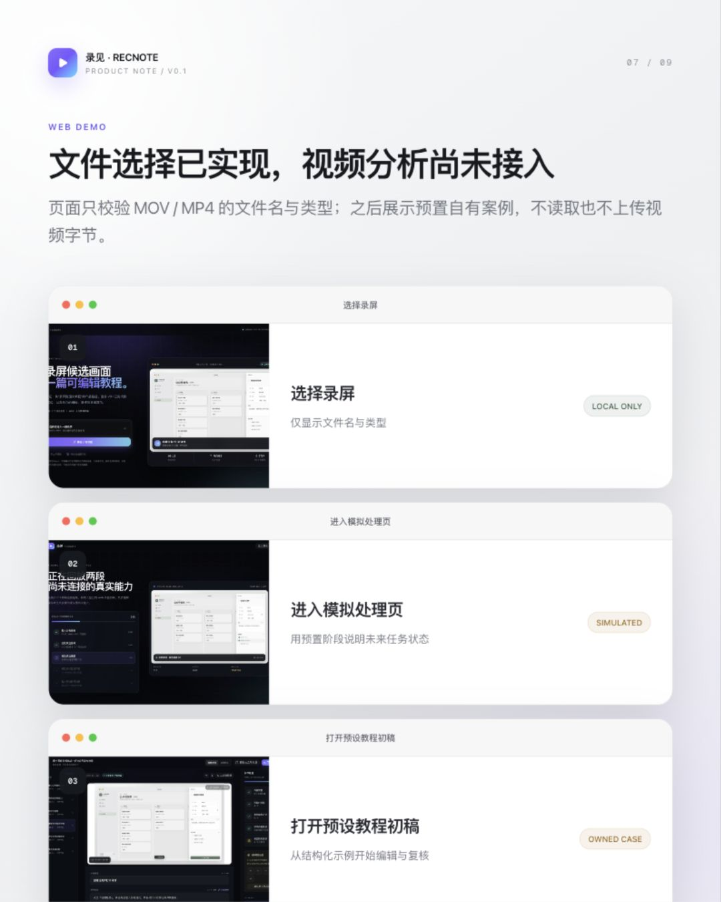
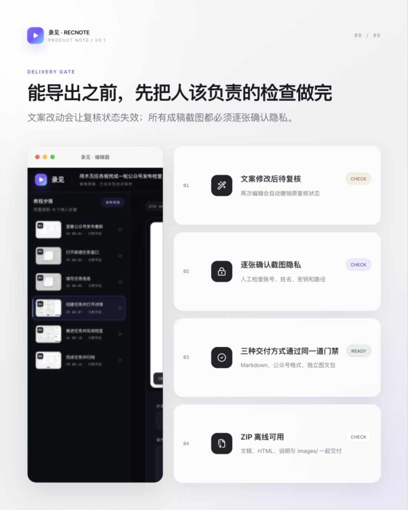
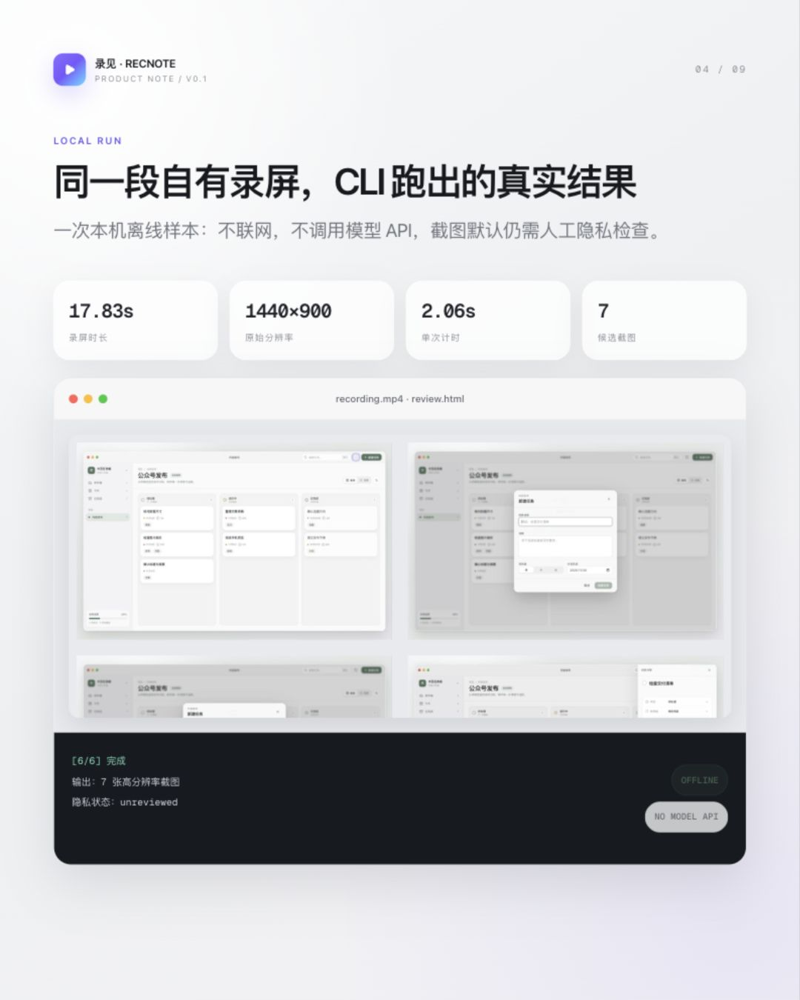
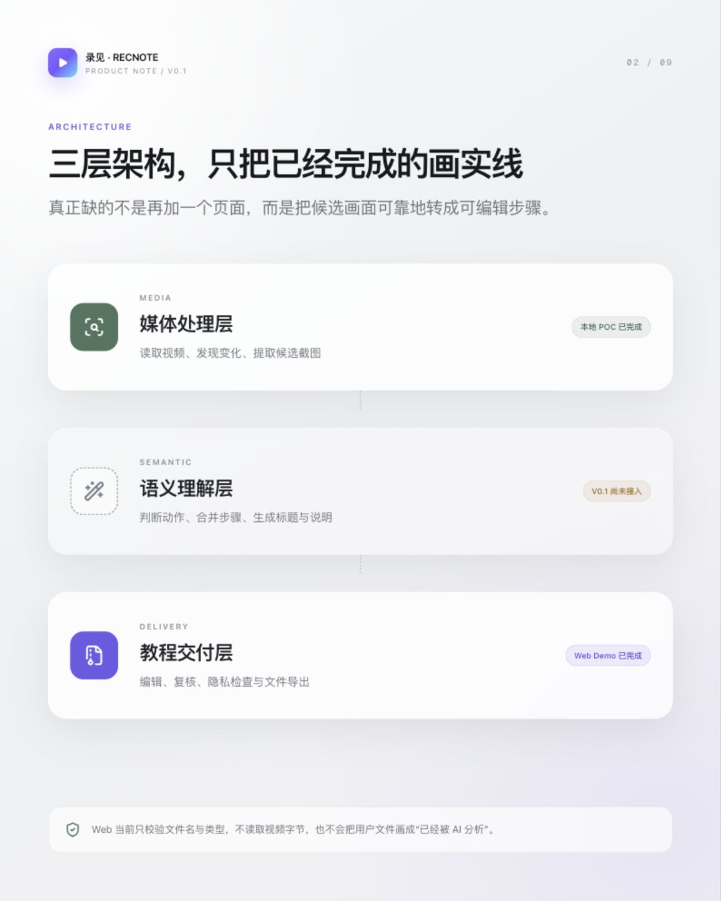
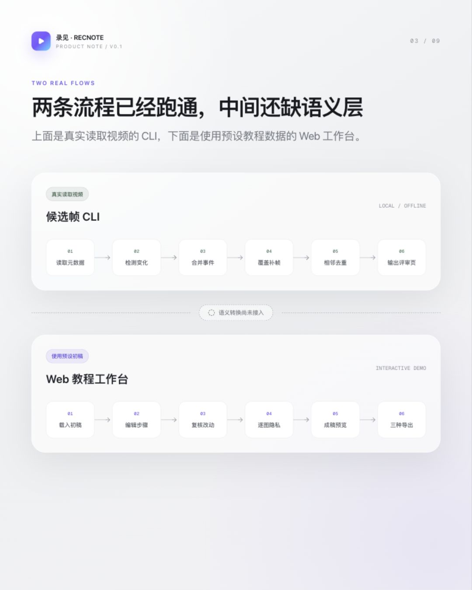
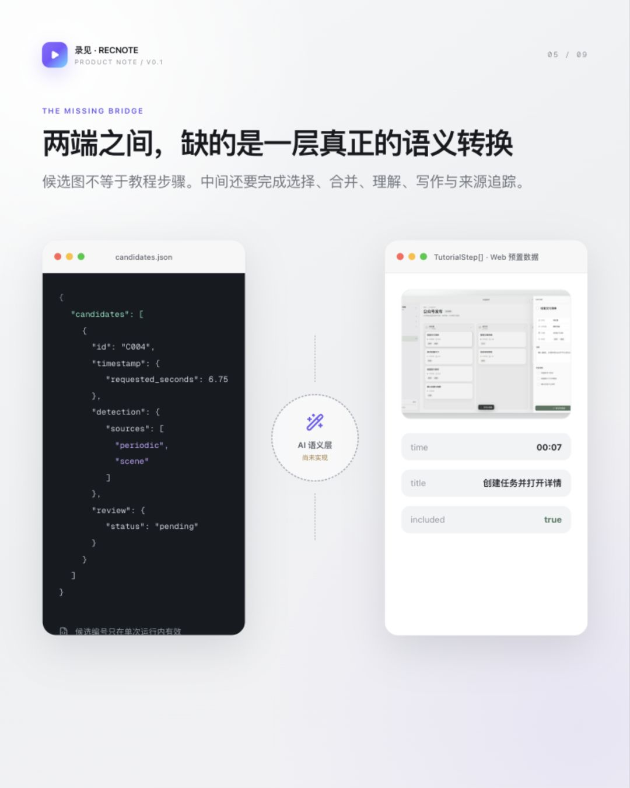
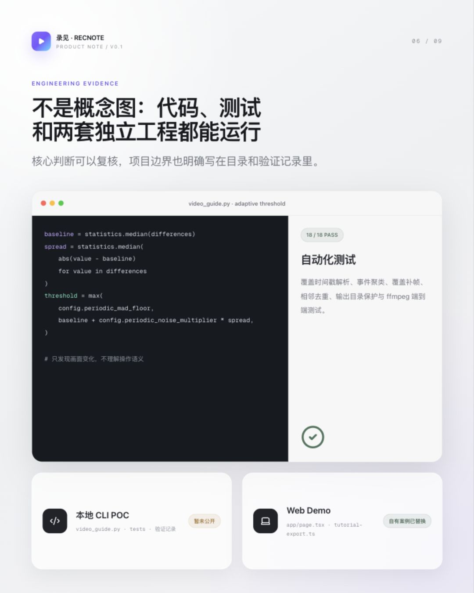
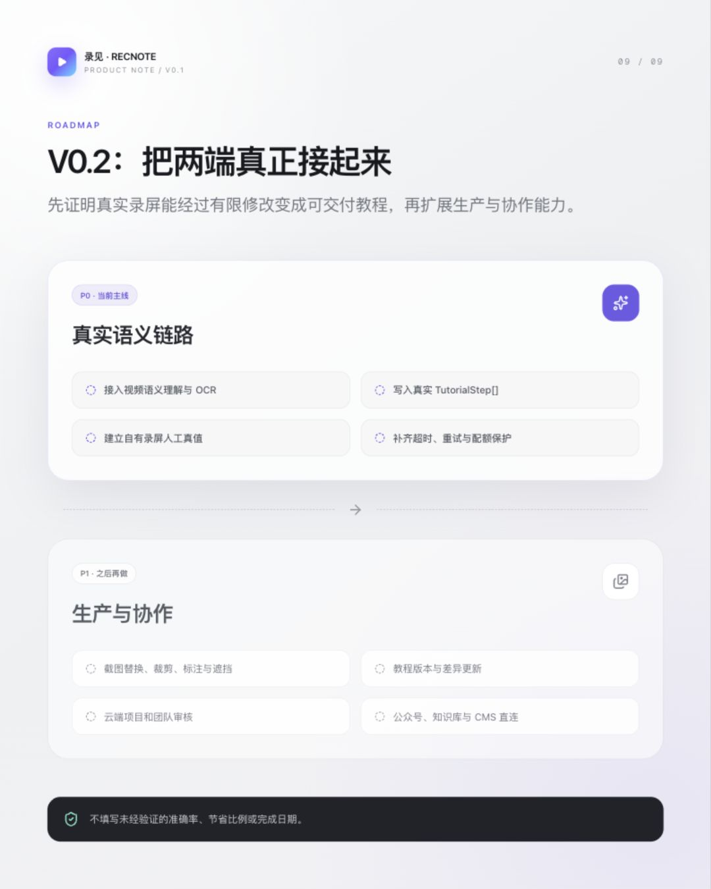

# 我做了个「录见」：18 秒录屏，约 2 秒挑出 7 张候选画面

> 摘要：最近我做了一个叫「录见」的工具，想解决录屏之后反复回看、截图、写步骤和检查隐私的重复工作。V0.1 已经跑通候选画面提取，以及教程编辑、复核和导出两端。

最近我在做一个东西，叫「录见」。

它来自一个很笨、却一直很耗时间的问题：

**操作过程明明已经录下来了，为什么写教程时还要再做一遍？**

为了把一段录屏整理成图文教程，我们通常还要重新播放视频、反复拖动进度条、找到关键画面、逐张截图、排列步骤，再补上标题和说明。

如果这份内容要公开发布，还得继续检查截图里有没有账号、姓名、密钥或者其他不该出现的信息。

录屏记录了“发生过什么”，却没有直接变成一份可以交付的内容。

我想让录见解决的，就是中间这段重复劳动。

先不讲宏大设想，直接看它现在已经跑起来的部分。

我用一段 17.83 秒的自有产品录屏做了测试。

本地候选帧工具在这台 Mac 上单次运行 2.06 秒，最后输出了 7 张候选画面；Web 端则用一份 6 步预置初稿，跑通了编辑、复核、隐私检查和导出流程。

这里先把能力边界说清楚：

- **7 张候选画面是真实从录屏中提取出来的；**
- **Web 里的 6 步教程是预置初稿，不是根据这 7 张截图自动生成的；**
- **负责理解操作含义、合并动作并生成教程文案的 AI 语义层，还没有接入。**

所以，当前的录见还不是一条“上传录屏，一键生成教程”的自动流水线。

它是两个已经分别跑起来、正在等待接通的端点。

> 产品演示视频：`../public/article/录见-V0.1-产品演示-无声字幕版.mp4`

## 一、现在的 Demo，真正验证了什么

Web 端目前验证的，不是“AI 已经生成了教程”。

它验证的是：当一份教程初稿出现以后，怎样经过人的编辑和检查，真正变成可以发布的内容。

### 1. 从一份预置初稿开始

首页可以选择 MOV 或 MP4 文件，也可以直接进入自有案例。

当前文件选择只会校验文件名与类型，不会读取、上传或分析视频内容。随后出现的处理进度和 6 步教程初稿，是为了演示完整编辑流程而预置的。

我把这条边界直接写在了页面里。因为一个概念 Demo 可以展示未来体验，但不能把模拟过程说成已经完成的能力。

### 2. 修改步骤，而不是接受一次性答案

进入编辑器后，可以修改文章标题、摘要、步骤标题和正文，也可以调整顺序，或者隐藏不需要纳入成稿的步骤。

我尤其在意一个细节：

**只要某段文案发生修改，它原来的“已复核”状态就会立即失效。**

内容经过修改以后，需要重新确认文字与画面是否一致，而不是沿用一个已经过期的“完成”标记。

### 3. 每一张成稿截图都要人工确认

截图是否包含账号、姓名、密钥或其他敏感内容，目前完全由人检查。

录见不会假装自己已经能够自动识别所有隐私信息。只要还有一张纳入成稿的截图没有确认，交付门禁就不会放行。

### 4. 三种交付方式，共用同一道门禁

当前提供三种交付方式：

- 复制 Markdown；
- 复制公众号格式；
- 下载独立图文包。

三种入口共用同一道检查逻辑：

- 标题、摘要和正文是否完整；
- 成稿步骤是否保留时间戳；
- 成稿步骤是否具有对应截图；
- 修改过的文案是否重新复核；
- 所有成稿截图是否完成人工隐私确认。

任何一项没有通过，交付都会被拦住。

在不支持富文本剪贴板的浏览器中，“复制公众号格式”会回退为 Markdown。下载的图文包则包含 Markdown、HTML 预览、使用说明和配套图片，解压后可以离线使用。

我现在越来越觉得，AI 内容产品真正重要的不是“生成了什么”，而是：

**生成结果能不能被检查、修改、追溯，并最终成为一份可以放心交付的东西。**

## 二、7 张候选画面是怎么来的

另一端，是已经能够真实运行的本地候选帧 CLI。

它不调用网络，也不使用模型 API。所有视频读取、变化检测和截图都在本机完成。

如果只是每隔几秒机械截一张图，很容易出现两个问题：

- 静止页面留下大量重复图片；
- 短暂出现的菜单、弹窗和状态变化刚好被错过。

因此，当前版本使用了两路信号：一路观察较明显的场景变化；另一路按固定频率比较相邻灰度画面的差异。

周期差异的判断不是使用一个固定阈值，而是根据当前视频自身的基础波动计算。达到阈值、同时构成局部变化峰值的时刻，才会成为候选信号。

之后程序还会合并临近事件、补充时间覆盖、过滤相邻重复画面，并限制最终候选数量。

这套方法并不知道用户点击了什么，也不理解画面的业务含义。它解决的是一个更基础的问题：

**先从整段视频里缩小人工需要检查的范围。**

这次使用的是木瓦任务板自有案例：

- 录屏时长：17.83 秒；
- 分辨率：1440 × 900；
- 帧率：30 fps；
- 本机单次运行：2.06 秒；
- 最终候选画面：7 张。

为了适配这段较短的录屏，本次运行显式调整了覆盖间隔和最大候选数。因此，这组数字只能说明当前样本能够跑通，不代表正式产品性能。

## 三、真正缺失的是中间这座桥

我把录见拆成了三层：

1. **媒体处理层**：从录屏中发现变化，提取值得继续检查的候选画面；
2. **语义理解层**：判断用户做了什么，合并连续动作，生成步骤标题和说明；
3. **教程交付层**：让人继续编辑、复核、检查截图并导出成品。

当前完成的是第一层的本地 POC，以及第三层的 Web Demo。

目前 CLI 和 Web 是两条独立流程：

CLI 输出的是候选画面、时间戳、检测信号和人工评审状态；Web 编辑器需要的，则是一组已经具有标题、正文、截图、时间和显示状态的教程步骤。

两端之间缺少的是这一段转换：

> `candidates[] → TutorialStep[]`

它至少需要完成四件事：

1. 判断哪些候选画面是真正的关键步骤；
2. 把属于同一个操作的连续画面合并起来；
3. 理解画面和操作对应的业务语义；
4. 生成可以继续编辑的步骤标题与说明。

这也是我为什么没有把当前版本包装成“一键把录屏变成教程”。

V0.1 的价值，是先验证两件事：前端能不能从录屏中稳定缩小候选范围；教程工作台能不能承接编辑、审核和交付。

两个端点成立以后，再接入语义理解层，问题会比一开始就做一个看似完整、却无法验证每个环节的黑盒更清楚。

## 四、这不是一张概念图

候选帧 CLI 目前有 18 项自动化测试，覆盖时间戳解析、短暂变化保留、事件合并、覆盖补帧、相邻去重、输出目录保护，以及由 ffmpeg 临时生成视频的端到端测试。

Web 端也已经完成构建检查和完整交互回归：从进入预置案例，到修改文案、重新复核、逐张检查截图，再到成功导出独立图文包。

在线 Demo：

[https://lujian-video-guide-demo.caiyiwenann.chatgpt.site/](https://lujian-video-guide-demo.caiyiwenann.chatgpt.site/)

自有录屏案例：

[https://lujian-video-guide-demo.caiyiwenann.chatgpt.site/cases/muwa-board](https://lujian-video-guide-demo.caiyiwenann.chatgpt.site/cases/muwa-board)

Web 源码：

[https://github.com/AnnCYW-cm/recnote](https://github.com/AnnCYW-cm/recnote)

候选帧 CLI 目前仍是本地技术 POC，暂未公开。

## 五、下一步只做一件事：把两端接起来

V0.2 暂时不扩展更多功能。

主线只有一条：

**让真实录屏经过候选画面提取和语义理解，生成可以进入 Web 工作台继续编辑的教程初稿。**

接下来优先完成：

1. 接入视频语义理解和 OCR；
2. 将真实结果写入 Web 工作台；
3. 保留视频、截图、时间戳和步骤之间的来源关系；
4. 用自有或已获授权的录屏建立人工真值；
5. 评测关键步骤召回、截图匹配情况和人工修改量。

至于截图裁剪、局部遮挡、教程版本更新、团队审核，以及公众号和知识库直连发布，都放在这条主链路跑通以后。

因为录见最终的判断标准，不应该是“模型返回了一段内容”。

而应该是：

**一段真实录屏，能不能经过有限修改，变成一份可以发布、培训或者交付的教程。**

如果你也经常把操作录屏整理成教程、SOP 或培训材料，欢迎告诉我：

**你最希望录见先替你省掉哪一步——反复回看、找截图、写步骤、排版，还是检查隐私？**

我会用这些真实反馈，决定 V0.2 的验证顺序。
